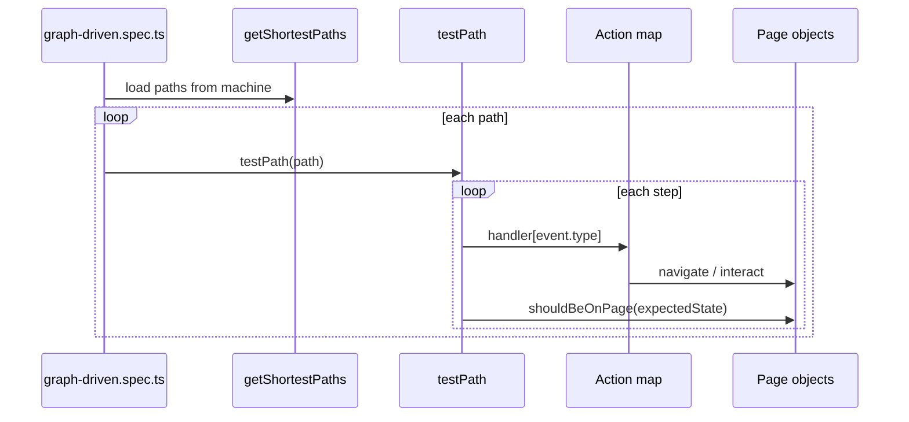

# Graph-Based E2E MBT

Proof of concept for **model-based testing (MBT)** with **Playwright** and **XState**. Application behavior is defined as a state machine; tests are generated from the graph at runtime. You do not write per-journey test cases.

## Core idea

Maintain only two things as the application evolves:

1. **The graph** — an XState machine that models real application behavior (`src/machines/`)
2. **The adapters** — page objects, selectors, and action handlers that execute events in the browser (`tests/support/`)

The test suite reads the machine, generates one Playwright test per shortest path, and runs each path by dispatching events to your action map.


## Quick start

```bash
npm install
npx playwright install chromium
cp .env.example .env   # set APP_EMAIL / APP_PASSWORD for live runs

# Fast graph smoke (no browser, stub actions)
npm test -- --project=stub

# Live E2E against app (BASE_URL)
npm test -- --project=app
```

## Project layout

```
src/
  machines/           # Pure XState models (no Playwright imports)
  mbt/
    graph/              # Path generation, labeling, testPath executor
    runner/             # MbtRunner (optional bulk execution API)

tests/
  mbt/
    graph-driven.spec.ts   # Single spec — generates all tests from the graph
  fixtures.ts              # Playwright fixtures (stub vs live)
  support/
    actions/                 # Event → page method adapters
    pages/                   # Page objects + should*() assertions per state
    app/                   # Site-specific overlay helpers
```

| Layer             | Location                         | Role                                                                 |
| ----------------- | -------------------------------- | -------------------------------------------------------------------- |
| Application model | `src/machines/*.machine.ts`      | States, transitions, events                                          |
| Path engine       | `src/mbt/graph/`                 | `getShortestPaths`, `getPathsFromEvents`, `testPath`, `describePath` |
| Action adapters   | `tests/support/actions/`         | Maps model events → Playwright calls                                 |
| Page objects      | `tests/support/pages/`           | Locators, navigation, state assertions                               |
| Generated tests   | `tests/mbt/graph-driven.spec.ts` | One Playwright test per graph path                                   |

## How tests are generated

At module load time, `graph-driven.spec.ts` calls `getAllShortestPaths(appAuthMachine)` from `@xstate/graph`. For each path it registers a Playwright test named after the target state and event sequence:

```
→ myAccount: GO_LOGIN → SUBMIT
→ error: GO_LOGIN → FAIL
→ home: GO_LOGIN → SUBMIT → LOGOUT
```

Each test runs `testPath()`, which:

1. Walks the path step by step
2. Dispatches each event to the matching handler in the action map
3. Verifies the browser is on the expected state via page object assertions

When you add a state or transition to the machine, new tests appear automatically. No journey spec is required.

## What you maintain

### 1. Machine (`src/machines/app-auth.machine.ts`)

Define states, transitions, and events. This is the source of truth for application behavior.

```typescript
login: {
  on: {
    SUBMIT: 'myAccount',
    FAIL: 'error',
  },
},
```

### 2. Actions (`tests/support/actions/app-auth.actions.ts`)

One handler per event type. Keys must match machine event names.

```typescript
GO_LOGIN: async (ctx) => { await pages.homePage.openLogin(); },
SUBMIT:   async (ctx) => { await pages.loginPage.submit(email, password); },
```

### 3. Page objects (`tests/support/pages/`)

Encapsulate selectors and navigation. Each page exposes `should*` methods (e.g. `shouldBeOnPage()`) for state verification.

### 4. State verifier registry (`tests/support/pages/state-verifier.ts`)

One line per machine state, mapping state name → page assertion. This is the only glue between model state names and UI checks.

```typescript
myAccount: () => pages.myAccountPage.shouldBeOnPage(),
error:     () => pages.loginPage.shouldShowError(),
```

## Adding new behavior

Example: add a `checkout` state after `myAccount`.

| Step | File                                        | Change                                                                               |
| ---- | ------------------------------------------- | ------------------------------------------------------------------------------------ |
| 1    | `src/machines/app-auth.machine.ts`          | Add `checkout` state, `GO_CHECKOUT` / `PAY` events and transitions                   |
| 2    | `tests/support/pages/checkout.page.ts`      | New `CheckoutPage` with `shouldBeOnPage()`                                           |
| 3    | `tests/fixtures.ts`                         | Add a `checkoutPage` fixture; pass it into the `actions` / `stateVerifier` factories |
| 4    | `tests/support/actions/app-auth.actions.ts` | Add `GO_CHECKOUT`, `PAY` handlers                                                    |
| 5    | `tests/support/pages/state-verifier.ts`     | Add `checkout: () => pages.checkoutPage.shouldBeOnPage()`                            |

Run `npm test -- --project=stub` to confirm new paths are generated. No changes to `graph-driven.spec.ts`.

## Specific journeys when needed

The default suite generates tests from `getShortestPaths`. When you need a particular flow — debug one route, cover a non-shortest path, or run a named scenario — you still do not write click-by-click specs. Pick the approach that fits.

| Situation                                 | Approach                                               |
| ----------------------------------------- | ------------------------------------------------------ |
| Journey is already generated              | `--grep` on the auto-generated test title              |
| Non-shortest route valid in the machine   | `getPathsFromEvents` with an event sequence            |
| Few recurring named flows                 | Thin `journeys` registry + optional `journeys.spec.ts` |
| Journey must always run in the full suite | Extend the machine so the graph includes it            |

### 1. Filter an existing generated journey (`--grep`)

Each generated test is titled `→ <targetState>: <event> → <event> → …`. Run one without code changes:

```bash
# All paths ending in myAccount
npm test -- --project=app --grep "→ myAccount"

# One specific route
npm test -- --project=app --grep "→ error: GO_LOGIN → FAIL"

# Longer non-obvious route (logout, re-login, then fail)
npm test -- --project=app --grep "→ error: GO_LOGIN → SUBMIT → LOGOUT → GO_LOGIN → FAIL"
```

When multiple paths reach the same state, `--grep "→ error"` runs all of them; include the full event sequence to run exactly one.

### 2. Define a journey as an event sequence (`getPathsFromEvents`)

Use this when the journey is valid in the machine but is **not** a shortest path (so it is not auto-generated). `@xstate/graph` resolves the event list into a path object; invalid sequences fail at resolution time.

```typescript
import { getPathsFromEvents } from 'xstate/graph';
import { appAuthMachine } from '../../src/machines/app-auth.machine.js';
import { testPath } from '../../src/mbt/graph/test-model-factory.js';
import { test } from '../fixtures.js';

const events = [
  { type: 'GO_LOGIN' },
  { type: 'SUBMIT' },
  { type: 'LOGOUT' },
  { type: 'GO_LOGIN' },
  { type: 'FAIL' },
] as const;

test('journey: re-login then fail', async ({
  mbtContext,
  actions,
  stateVerifier,
}) => {
  const [path] = getPathsFromEvents(appAuthMachine, [...events]);

  if (!path) {
    throw new Error('Journey is not valid in the current machine');
  }

  await testPath(path, mbtContext, {
    actions,
    verifyState: stateVerifier,
  });
});
```

You still only maintain the **machine** and **actions/pages** — the event list is a compact journey selector validated by the graph, not a duplicate test script.

Run it:

```bash
npm test -- --project=app --grep "journey: re-login then fail"
```

### 3. Named journeys registry (optional)

If you have several recurring ad-hoc flows, centralize event sequences in one file instead of scattering specs:

```typescript
// tests/support/journeys.ts
export const journeys = {
  reLoginFailure: [
    { type: 'GO_LOGIN' },
    { type: 'SUBMIT' },
    { type: 'LOGOUT' },
    { type: 'GO_LOGIN' },
    { type: 'FAIL' },
  ],
} as const;
```

```typescript
// tests/mbt/journeys.spec.ts
import { getPathsFromEvents } from 'xstate/graph';
import { appAuthMachine } from '../../src/machines/app-auth.machine.js';
import { testPath } from '../../src/mbt/graph/test-model-factory.js';
import { journeys } from '../support/journeys.js';
import { test } from '../fixtures.js';

for (const [name, events] of Object.entries(journeys)) {
  test(`journey: ${name}`, async ({ mbtContext, actions, stateVerifier }) => {
    const [path] = getPathsFromEvents(appAuthMachine, [...events]);
    await testPath(path!, mbtContext, { actions, verifyState: stateVerifier });
  });
}
```

```bash
npm test -- --project=app --grep "journey: reLoginFailure"
```

This file is optional. Add it only when `--grep` or a one-off `getPathsFromEvents` test is not enough.

### 4. Model the journey in the machine

If a journey is business-critical and should **always** appear in the default generated suite, express it in the machine (states, transitions, or branches) so `getShortestPaths` or `getSimplePaths` picks it up. Then no extra spec or registry is needed — `graph-driven.spec.ts` generates the test automatically.

### What you still do not write

- Per-step Playwright clicks in specs
- Duplicate URL/visibility assertions (still `stateVerifier` + page `shouldBeOnPage()`)
- New action handlers unless the journey introduces new events

## Running tests

### Projects

| Project | Browser          | Actions        | Use case                    |
| ------- | ---------------- | -------------- | --------------------------- |
| `stub`  | Mock (no launch) | Log-only stubs | Fast graph / wiring checks  |
| `app`   | Chromium         | Live app pages | Real E2E against `BASE_URL` |

```bash
npm test                        # both projects
npm test -- --project=stub      # graph smoke only
npm run test:app              # live E2E only
npm run test:ui                 # Playwright UI mode
```

See [Specific journeys when needed](#specific-journeys-when-needed) for `--grep`, `getPathsFromEvents`, and named journey patterns.

### Environment variables

| Variable       | Default                        | Purpose                                     |
| -------------- | ------------------------------ | ------------------------------------------- |
| `BASE_URL`     | `https://www.g-star.com/en_nl` | Application under test                      |
| `APP_EMAIL`    | —                              | Login email (required for `app` project)    |
| `APP_PASSWORD` | —                              | Login password (required for `app` project) |

Copy `.env.example` to `.env` and fill in credentials for live runs.

## Coverage model

This POC uses **`getShortestPaths`** — one minimal path per reachable state.

| Model change                          | Test impact                                    |
| ------------------------------------- | ---------------------------------------------- |
| New reachable state                   | +1 generated test (typically)                  |
| Alternate route to existing state     | Often no new test (shortest path unchanged)    |
| New loop (e.g. logout → home → login) | May add paths to states reachable via the loop |

For exhaustive or alternate-path coverage, extend `src/mbt/graph/path-generator.ts` (e.g. `getSimplePaths`, adjacency-guided walks) or use [`getPathsFromEvents`](#2-define-a-journey-as-an-event-sequence-getpathsfromevents) for a single named journey. The default spec layer stays the same.

## Execution flow



## Scripts

| Command            | Description                 |
| ------------------ | --------------------------- |
| `npm test`         | Run all Playwright projects |
| `npm run test:mbt` | Run MBT specs only          |
| `npm run test:app` | Live app E2E project        |
| `npm run test:ui`  | Playwright UI mode          |

## Design constraints

- **Sequential execution** — `workers: 1`, paths are not parallelized (MBT journeys are stateful).
- **Machine is pure** — no Playwright imports in `src/machines/`.
- **Events drive actions** — action map keys must match machine event `type` strings exactly.
- **State names drive verification** — verifier registry keys must match machine state names.
