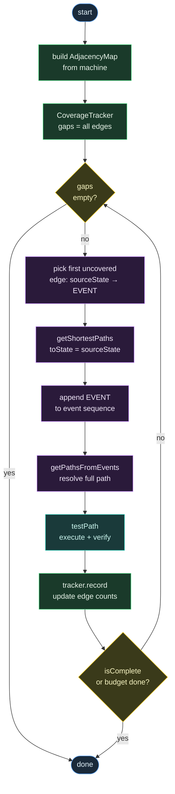
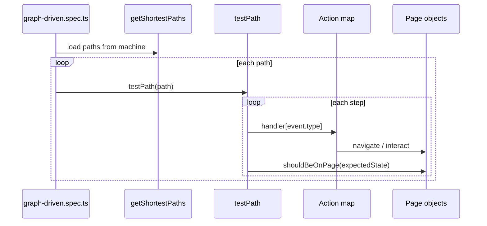

# Graph-Based E2E MBT

Proof of concept for **model-based testing (MBT)** with **Playwright** and **XState**. Application behavior is defined as a state machine; tests are generated from the graph at runtime. You do not write per-journey test cases.

## Core idea

Maintain only two things as the application evolves:

1. **The graph** — an XState machine that models real application behavior (`src/machines/`)
2. **The adapters** — page objects, selectors, and action handlers that execute events in the browser (`tests/support/`)

The test suite reads the machine, generates one Playwright test per shortest path, and runs each path by dispatching events to your action map.


## Quick start

```bash
npm install
npx playwright install chromium
cp .env.example .env   # set APP_EMAIL / APP_PASSWORD for live runs

# Fast graph smoke (no browser, stub actions)
npm test -- --project=stub

# Live E2E against app (BASE_URL)
npm test -- --project=app
```

## Project layout

```
src/
  machines/           # Pure XState models (no Playwright imports)
  mbt/
    graph/              # Path generation, labeling, testPath executor
  exploration/        # Autonomous-exploration core (browser-independent, no Playwright imports)

tests/
  mbt/
    graph-driven.spec.ts            # Auth graph — one test per shortest path
    shopping-graph-driven.spec.ts   # Shopping graph — discovery→product→favorites/cart→checkout
  exploration/                      # Browser-free exploration specs (recorder, guardrails, trace parser) + parse-run runner
  fixtures.ts                       # Playwright fixtures (stub vs live)
  support/
    actions/                        # Event → page method adapters
    pages/                          # Page objects + should*() assertions per state
    app/                            # Site-specific overlay helpers
    config/                         # Credentials + PRODUCT_PATH
    exploration/                    # Guardrail-script generator + post-hoc trace parser

config/
  app-context.md      # Authored per-site profile that grounds the exploration agent
  guardrails/         # Per-site guardrail data (+ generated init scripts)
.mcp.json             # Registers the Playwright MCP server used by /explore
.claude/commands/
  explore.md          # /explore <target> agent-driven exploration command
```

| Layer             | Location                         | Role                                                                 |
| ----------------- | -------------------------------- | -------------------------------------------------------------------- |
| Application model | `src/machines/*.machine.ts`      | States, transitions, events                                          |
| Path engine       | `src/mbt/graph/`                 | `getShortestPaths`, `getPathsFromEvents`, `testPath`, `describePath` |
| Action adapters   | `tests/support/actions/`         | Maps model events → Playwright calls                                 |
| Page objects      | `tests/support/pages/`           | Locators, navigation, state assertions                               |
| Generated tests   | `tests/mbt/graph-driven.spec.ts` | One Playwright test per graph path                                   |

## How tests are generated

At module load time, `graph-driven.spec.ts` calls `getAllShortestPaths(appAuthMachine)` from `@xstate/graph`. For each path it registers a Playwright test named after the target state and event sequence:

```
→ myAccount: GO_LOGIN → SUBMIT
→ error: GO_LOGIN → FAIL
→ home: GO_LOGIN → SUBMIT → LOGOUT
```

Each test runs `testPath()`, which:

1. Walks the path step by step
2. Dispatches each event to the matching handler in the action map
3. Verifies the browser is on the expected state via page object assertions

When you add a state or transition to the machine, new tests appear automatically. No journey spec is required.

## What you maintain

### 1. Machine (`src/machines/app-auth.machine.ts`)

Define states, transitions, and events. This is the source of truth for application behavior.

```typescript
login: {
  on: {
    SUBMIT: 'myAccount',
    FAIL: 'error',
  },
},
```

### 2. Actions (`tests/support/actions/app-auth.actions.ts`)

One handler per event type. Keys must match machine event names.

```typescript
GO_LOGIN: async (ctx) => { await pages.homePage.openLogin(); },
SUBMIT:   async (ctx) => { await pages.loginPage.submit(email, password); },
```

### 3. Page objects (`tests/support/pages/`)

Encapsulate selectors and navigation. Each page exposes `should*` methods (e.g. `shouldBeOnPage()`) for state verification.

### 4. State verifier registry (`tests/support/pages/state-verifier.ts`)

One line per machine state, mapping state name → page assertion. This is the only glue between model state names and UI checks.

```typescript
myAccount: () => pages.myAccountPage.shouldBeOnPage(),
error:     () => pages.loginPage.shouldShowError(),
```

## Adding new behavior

Example: add a `checkout` state after `myAccount`.

| Step | File                                        | Change                                                                               |
| ---- | ------------------------------------------- | ------------------------------------------------------------------------------------ |
| 1    | `src/machines/app-auth.machine.ts`          | Add `checkout` state, `GO_CHECKOUT` / `PAY` events and transitions                   |
| 2    | `tests/support/pages/checkout.page.ts`      | New `CheckoutPage` with `shouldBeOnPage()`                                           |
| 3    | `tests/fixtures.ts`                         | Add a `checkoutPage` fixture; pass it into the `actions` / `stateVerifier` factories |
| 4    | `tests/support/actions/app-auth.actions.ts` | Add `GO_CHECKOUT`, `PAY` handlers                                                    |
| 5    | `tests/support/pages/state-verifier.ts`     | Add `checkout: () => pages.checkoutPage.shouldBeOnPage()`                            |

Run `npm test -- --project=stub` to confirm new paths are generated. No changes to `graph-driven.spec.ts`.

## Specific journeys when needed

The default suite generates tests from `getShortestPaths`. When you need a particular flow — debug one route, cover a non-shortest path, or run a named scenario — you still do not write click-by-click specs. Pick the approach that fits.

| Situation                                 | Approach                                               |
| ----------------------------------------- | ------------------------------------------------------ |
| Journey is already generated              | `--grep` on the auto-generated test title              |
| Non-shortest route valid in the machine   | `getPathsFromEvents` with an event sequence            |
| Few recurring named flows                 | Thin `journeys` registry + optional `journeys.spec.ts` |
| Journey must always run in the full suite | Extend the machine so the graph includes it            |

### 1. Filter an existing generated journey (`--grep`)

Each generated test is titled `→ <targetState>: <event> → <event> → …`. Run one without code changes:

```bash
# All paths ending in myAccount
npm test -- --project=app --grep "→ myAccount"

# One specific route
npm test -- --project=app --grep "→ error: GO_LOGIN → FAIL"

# Longer non-obvious route (logout, re-login, then fail)
npm test -- --project=app --grep "→ error: GO_LOGIN → SUBMIT → LOGOUT → GO_LOGIN → FAIL"
```

When multiple paths reach the same state, `--grep "→ error"` runs all of them; include the full event sequence to run exactly one.

### 2. Define a journey as an event sequence (`getPathsFromEvents`)

Use this when the journey is valid in the machine but is **not** a shortest path (so it is not auto-generated). `@xstate/graph` resolves the event list into a path object; invalid sequences fail at resolution time.

```typescript
import { getPathsFromEvents } from 'xstate/graph';
import { appAuthMachine } from '../../src/machines/app-auth.machine.js';
import { testPath } from '../../src/mbt/graph/test-model-factory.js';
import { test } from '../fixtures.js';

const events = [
  { type: 'GO_LOGIN' },
  { type: 'SUBMIT' },
  { type: 'LOGOUT' },
  { type: 'GO_LOGIN' },
  { type: 'FAIL' },
] as const;

test('journey: re-login then fail', async ({
  mbtContext,
  actions,
  stateVerifier,
}) => {
  const [path] = getPathsFromEvents(appAuthMachine, [...events]);

  if (!path) {
    throw new Error('Journey is not valid in the current machine');
  }

  await testPath(path, mbtContext, {
    actions,
    verifyState: stateVerifier,
  });
});
```

You still only maintain the **machine** and **actions/pages** — the event list is a compact journey selector validated by the graph, not a duplicate test script.

Run it:

```bash
npm test -- --project=app --grep "journey: re-login then fail"
```

### 3. Named journeys registry (optional)

If you have several recurring ad-hoc flows, centralize event sequences in one file instead of scattering specs:

```typescript
// tests/support/journeys.ts
export const journeys = {
  reLoginFailure: [
    { type: 'GO_LOGIN' },
    { type: 'SUBMIT' },
    { type: 'LOGOUT' },
    { type: 'GO_LOGIN' },
    { type: 'FAIL' },
  ],
} as const;
```

```typescript
// tests/mbt/journeys.spec.ts
import { getPathsFromEvents } from 'xstate/graph';
import { appAuthMachine } from '../../src/machines/app-auth.machine.js';
import { testPath } from '../../src/mbt/graph/test-model-factory.js';
import { journeys } from '../support/journeys.js';
import { test } from '../fixtures.js';

for (const [name, events] of Object.entries(journeys)) {
  test(`journey: ${name}`, async ({ mbtContext, actions, stateVerifier }) => {
    const [path] = getPathsFromEvents(appAuthMachine, [...events]);
    await testPath(path!, mbtContext, { actions, verifyState: stateVerifier });
  });
}
```

```bash
npm test -- --project=app --grep "journey: reLoginFailure"
```

This file is optional. Add it only when `--grep` or a one-off `getPathsFromEvents` test is not enough.

### 4. Model the journey in the machine

If a journey is business-critical and should **always** appear in the default generated suite, express it in the machine (states, transitions, or branches) so `getShortestPaths` or `getSimplePaths` picks it up. Then no extra spec or registry is needed — `graph-driven.spec.ts` generates the test automatically.

### What you still do not write

- Per-step Playwright clicks in specs
- Duplicate URL/visibility assertions (still `stateVerifier` + page `shouldBeOnPage()`)
- New action handlers unless the journey introduces new events

## Running tests

### Projects

| Project | Browser          | Actions        | Use case                    |
| ------- | ---------------- | -------------- | --------------------------- |
| `stub`  | Mock (no launch) | Log-only stubs | Fast graph / wiring checks  |
| `app`   | Chromium         | Live app pages | Real E2E against `BASE_URL` |

```bash
npm test                        # both projects
npm test -- --project=stub      # graph smoke only
npm run test:app              # live E2E only
npm run test:ui                 # Playwright UI mode
```

See [Specific journeys when needed](#specific-journeys-when-needed) for `--grep`, `getPathsFromEvents`, and named journey patterns.

### Environment variables

| Variable       | Default                        | Purpose                                     |
| -------------- | ------------------------------ | ------------------------------------------- |
| `BASE_URL`     | `https://www.g-star.com/en_nl` | Application under test                      |
| `APP_EMAIL`    | —                              | Login email (required for `app` project)    |
| `APP_PASSWORD` | —                              | Login password (required for `app` project) |
| `BB_EMAIL`     | —                              | Test-account email `/explore` uses for real login / authenticated scenarios (optional) |
| `BB_PASSWORD`  | —                              | Test-account password for the above (optional; without it, `/explore` does negative auth probes only) |

Copy `.env.example` to `.env` and fill in credentials for live runs. `BB_EMAIL`/`BB_PASSWORD` are secrets — never echoed into reports, and traces (which capture typed values) are git-ignored.

## Coverage model

This POC uses `getShortestPaths` — one minimal path per reachable state.

| Model change                          | Test impact                                    |
| ------------------------------------- | ---------------------------------------------- |
| New reachable state                   | +1 generated test (typically)                  |
| Alternate route to existing state     | Often no new test (shortest path unchanged)    |
| New loop (e.g. logout → home → login) | May add paths to states reachable via the loop |

For exhaustive or alternate-path coverage, extend `src/mbt/graph/path-generator.ts` (e.g. `getSimplePaths`, adjacency-guided walks) or use `[getPathsFromEvents](#2-define-a-journey-as-an-event-sequence-getpathsfromevents)` for a single named journey. The default spec layer stays the same.

## Coverage-driven exploration loop

An alternative to the static `getShortestPaths` suite. Instead of pre-generating a fixed list of paths, the loop inspects which edges in the machine graph are still uncovered after each path execution and generates the next path on demand — iterating until either the coverage target is reached or the iteration budget runs out.

This mirrors the feedback-loop pattern used in LLM-based exploration (generate → run → measure gaps → regenerate), but entirely without an LLM: the gap detection and path generation are computed directly from the graph.



### XState APIs used

| API                                      | Role in the loop                                                                                                                                                                                      |
| ---------------------------------------- | ----------------------------------------------------------------------------------------------------------------------------------------------------------------------------------------------------- |
| `getAdjacencyMap(machine)`               | Builds the complete edge universe `{ sourceState → { event → targetState } }` at startup. The tracker uses this as the coverage denominator.                                                          |
| `getShortestPaths(machine, { toState })` | For each uncovered edge, finds the minimal event sequence that reaches the edge's source state.                                                                                                       |
| `getPathsFromEvents(machine, events[])`  | Appends the gap event to the sequence above and resolves the full path. This handles **back-edges** (e.g. `LOGOUT → home`) that `getSimplePaths` cannot reach because they revisit the initial state. |
| `testPath(path, ctx, options)`           | Executes the path: dispatches each event to the action map and calls the state verifier at each step.                                                                                                 |

#### Why `getPathsFromEvents` instead of `getSimplePaths`

`getSimplePaths` returns all acyclic paths — it never visits the same state twice. This means back-edges that loop back to the initial state (like `myAccount → LOGOUT → home`) are unreachable because `home` appears at both start and end of the path.

`getPathsFromEvents` takes an explicit event sequence and resolves it against the machine regardless of cycles, so the loop can exercise any edge including transitions that form cycles.

```
Gap: myAccount:LOGOUT → targetState=home

1. getShortestPaths({ toState: s => s === 'myAccount' })
   → steps: [GO_LOGIN, SUBMIT]

2. append gap event
   → events: [GO_LOGIN, SUBMIT, LOGOUT]

3. getPathsFromEvents(machine, [GO_LOGIN, SUBMIT, LOGOUT])
   → path: home → login → myAccount → home  ✓
```

### Persona support

When multiple personas are provided, each iteration cycles through them and skips paths whose event sequences fall outside a persona's `allowedEvents`. This lets you partition coverage responsibility across personas without losing overall coverage.

```typescript
const personas: PersonaConfig[] = [
  { name: 'happy_path', allowedEvents: ['GO_LOGIN', 'SUBMIT', 'LOGOUT'] },
  { name: 'error_path', allowedEvents: ['GO_LOGIN', 'FAIL'] },
];
```

`happy_path` covers the success branch; `error_path` covers the failure branch. Together they satisfy 100% edge coverage.

### Weights

The `weights` option controls two independent things with one `Weights` object:

```typescript
type Weights = {
  edges?: Record<string, number>; // "sourceState:EVENT" → minimum visit count + sort priority
  states?: Record<string, number>; // stateName → priority boost for gaps targeting this state
};
```

#### Edge weights — repeat visits and priority

`edges` maps an edge key (`"sourceState:EVENT"`) to a **minimum visit count**. An edge is not removed from the gap list until it has been traversed at least that many times. Higher values also sort the edge earlier in the gap list, so it is addressed before lower-weight edges.

```typescript
// login:SUBMIT must be traversed 3 times before the loop moves on.
// Because its weight (3) exceeds all others (1), it is picked first every time
// it still has remaining visits.
const weights: Weights = {
  edges: { 'login:SUBMIT': 3 },
};
```

Iteration log with edge weight 3 on `login:SUBMIT`:

```
[iteration 1] gap="login:SUBMIT" visits=0/3 path="→ myAccount: GO_LOGIN → SUBMIT"  coverage=0%
[iteration 2] gap="login:SUBMIT" visits=1/3 path="→ myAccount: GO_LOGIN → SUBMIT"  coverage=25%
[iteration 3] gap="login:SUBMIT" visits=2/3 path="→ myAccount: GO_LOGIN → SUBMIT"  coverage=25%
[iteration 4] gap="login:FAIL"   visits=0/1 path="→ error: GO_LOGIN → FAIL"        coverage=50%
[iteration 5] gap="myAccount:LOGOUT" visits=0/1 path="→ home: GO_LOGIN → SUBMIT → LOGOUT" coverage=75%
```

The coverage percentage stays at 25% during iterations 2 and 3 because `visitedEdges` counts edges that have **met** their minimum, not edges touched at least once.

#### State weights — gap ordering priority

`states` maps a state name to a **priority boost** applied when sorting gaps. It does not change the minimum visit count — it only affects which gap is addressed first when multiple gaps have equal edge weights.

```typescript
// Gaps whose targetState is myAccount get score = edgeWeight(1) + stateBoost(10) = 11.
// Gaps to other states get score = 1. So login:SUBMIT is always before login:FAIL.
const weights: Weights = {
  states: { myAccount: 10 },
};
```

#### Sort score formula

```
score(gap) = (edges[gap.sourceState:gap.event] ?? 1) + (states[gap.targetState] ?? 0)
```

Gaps are sorted descending by score — highest score is addressed first each iteration.

### Usage

```typescript
import { runCoverageLoop } from '../../src/mbt/graph/exploration-loop.js';

const report = await runCoverageLoop(appAuthMachine, mbtContext, {
  actions,
  verifyState: stateVerifier,
  budget: {
    maxIterations: 10, // max path executions before stopping
    targetEdgePct: 100, // stop early once this weighted-coverage % is reached
  },
  // optional:
  personas: [...],
  weights: {
    edges:  { 'login:SUBMIT': 3 },
    states: { myAccount: 10 },
  },
});

// report: { totalEdges, visitedEdges, edgesPct, totalStates, visitedStates, statesPct }
// visitedEdges = edges that have met their weighted minimum visit count
```

Each path execution logs iteration number, persona, gap key, current/minimum visit count, resolved path, and weighted coverage:

```
[iteration 1] persona="default" gap="home:GO_LOGIN"    visits=0/1 path="→ login: GO_LOGIN"                  coverage=0%
[iteration 2] persona="default" gap="login:SUBMIT"     visits=0/1 path="→ myAccount: GO_LOGIN → SUBMIT"      coverage=25%
[iteration 3] persona="default" gap="login:FAIL"       visits=0/1 path="→ error: GO_LOGIN → FAIL"            coverage=50%
[iteration 4] persona="default" gap="myAccount:LOGOUT" visits=0/1 path="→ home: GO_LOGIN → SUBMIT → LOGOUT"  coverage=75%
```

The sample spec lives at `tests/mbt/coverage-loop.spec.ts`. Run it:

```bash
npm test -- --project=stub --grep "Coverage Loop"
```

### Comparison with static shortest-paths

|                         | `getShortestPaths` (default)                      | Coverage loop                                             |
| ----------------------- | ------------------------------------------------- | --------------------------------------------------------- |
| Path count              | Fixed — one per reachable state                   | Dynamic — one per uncovered edge                          |
| Back-edge coverage      | Only if it creates a new shortest path to a state | Always — `getPathsFromEvents` resolves any valid sequence |
| Coverage guarantee      | All states reachable from initial                 | All edges in the machine, provably                        |
| Iteration               | Single pass                                       | Iterative until gaps closed or budget exhausted           |
| Persona support         | No                                                | Yes — per-persona `allowedEvents` filtering               |
| Repeat visits           | No                                                | Yes — `weights.edges` sets per-edge minimum visit count   |
| Gap ordering / priority | No                                                | Yes — `weights.edges` + `weights.states` sort score       |

## Execution flow



## Scripts

| Command            | Description                 |
| ------------------ | --------------------------- |
| `npm test`         | Run all Playwright projects |
| `npm run test:mbt` | Run MBT specs only          |
| `npm run test:app` | Live app E2E project        |
| `npm run test:ui`  | Playwright UI mode          |

## Autonomous exploration (POC)

A second, **independent** subsystem (it does not reuse the MBT engine). Given only a **semantic target** — an intent such as `pdp`, `cart`, or `guest checkout`, never a URL — an agent explores the live storefront (`BASE_URL`), records a state/transition graph plus telemetry, and emits a report. Entry page, budget, safety, and stop conditions are internal defaults; the input is the target plus an optional `:: <scope & risks>` note.

The **in-session agent (Claude) drives Microsoft's Playwright MCP directly** — `browser_navigate` → `browser_snapshot` → reason → `browser_click`/`type`/`select`, with tracing on — then a **post-hoc parser** reads the recorded trace (the raw, uncompressed `trace-<ts>.trace` the MCP writes — no `unzip`; a bundled `trace.zip` is a fallback only) and emits the artifacts. There is **no AI SDK or API key** (the LLM is the session), and no bespoke browser host or file channel. The `/explore <target>` slash command (`.claude/commands/explore.md`) runs the whole flow.

> **Design note.** This replaced an earlier engine (a Node `coordinator` loop, a `PlaywrightHost`, `Heuristic`/`AgentDecider`, a file channel, and a self-driving autonomous mode). See `docs/ai-exploratory-architecture.md` → "Key decisions" for the rationale and what changed.

### Flow

1. Agent starts tracing (`browser_start_tracing`), resolves the entry from `config/app-context.md`, and navigates.
2. Loop (≤ 10 acting steps / 15 states, POC budget): snapshot → choose one on-target action → act. Cover happy paths **and** negative probes; for auth targets, do a real sign-in with the `BB_EMAIL`/`BB_PASSWORD` test account from `.env`.
3. Agent stops tracing; the parser runner reads the newest raw `.trace` and turns it into `graph.json` / `issues.json` / `report.md`.

### Safety (page-side guardrail)

Because the agent calls `browser_click` directly, safety is a **page-side guardrail**, not an un-bypassable tool gate. An init-script (`config/guardrails/<site>.init.js`, loaded via the MCP server's `--init-script`) runs on every page and **neutralizes consequential controls** (matched against the shared `consequence-policy` patterns — e.g. order, payment, purchase, personal-data, destructive, send, publish; login/sign-up/register are intentionally explorable) and dismisses the cookie/consent overlay. The budget (10 acting steps / 15 states, POC) is prompt-enforced by the skill. Site-specific data (overlay selectors, extra consequential names) lives in `config/guardrails/<site>.json` — **context, not code**.

### Telemetry & artifacts

The parser derives signals from the trace's console stream — `consoleError`, plus `httpError`/`requestFailed` (network 4xx/failures mirror into console) and `pageError`. Each is classified **first-party** (site domain) vs **third-party** (external vendor); the report separates site issues from vendor noise. Issues are deduped by message with a total count and an affected-transitions tally.

Each run writes to `artifacts/exploration/<run-id>/` (git-ignored): `manifest.json`, `graph.json`, `errors.json`, `issues.json`, `report.md`, and `evidence/`.

### Key files

| File                                          | Role                                                      |
| --------------------------------------------- | --------------------------------------------------------- |
| `.mcp.json`                                   | Registers the Playwright MCP server (tracing + guardrail) |
| `.claude/commands/explore.md`                 | The `/explore <target>` agent-driven flow                 |
| `tests/support/exploration/guardrails.ts`     | Generates the page-side guardrail init-script             |
| `tests/support/exploration/trace-parser.ts`   | Post-hoc trace → artifacts; reads the raw `.trace` (the only trace reader) |
| `tests/exploration/parse-run.spec.ts`         | Browser-free runner that invokes the parser               |
| `src/exploration/recorder.ts` / `issues.ts`   | Step/graph/signal recording + issue dedup                 |
| `src/exploration/report.ts`                   | `report.md` + full artifact set                           |
| `src/exploration/consequence-policy.ts`       | Site-agnostic consequence patterns (feed the guardrail)   |
| `config/app-context.md`, `config/guardrails/` | Per-site profile + guardrail data (context, not code)     |

### Running

```bash
# Browser-free exploration suite (unit-tests the core + guardrail + parser)
npm test -- --project=exploration

# Agent-driven live run (you drive Playwright MCP; needs the MCP server loaded)
/explore pdp        # Claude Code slash command
```

`src/exploration/` stays Playwright-free (like `src/machines/`), so the whole telemetry core is testable without a browser. The migration adds `@playwright/mcp` (consumed via `npx`); the parser reads the raw `.trace` directly and uses the system `unzip` only as a fallback for a bundled `.zip`. No runtime schema library.

## Design constraints

- **Sequential execution** — `workers: 1`, paths are not parallelized (MBT journeys are stateful).
- **Machine is pure** — no Playwright imports in `src/machines/`.
- **Events drive actions** — action map keys must match machine event `type` strings exactly.
- **State names drive verification** — verifier registry keys must match machine state names.
