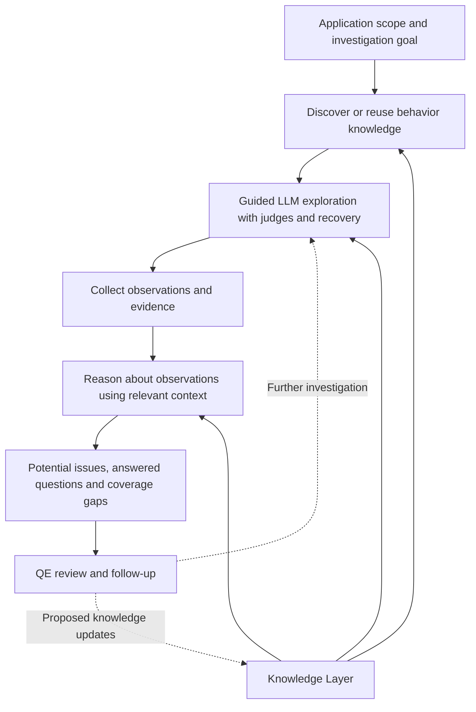
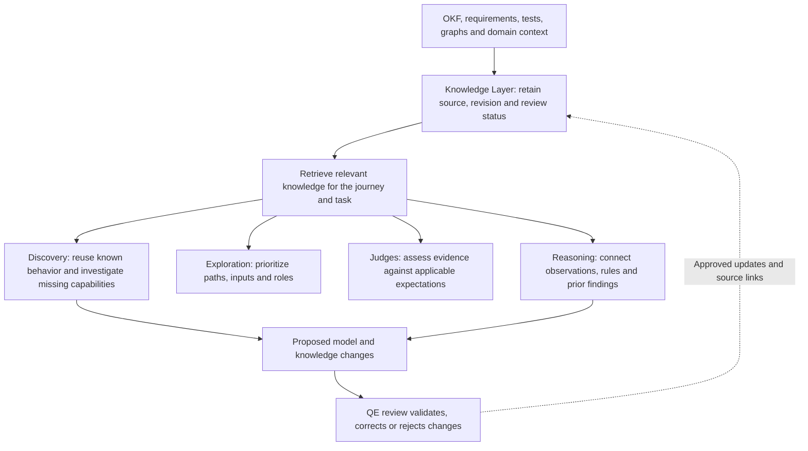
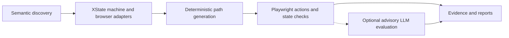
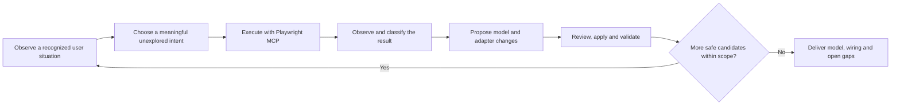
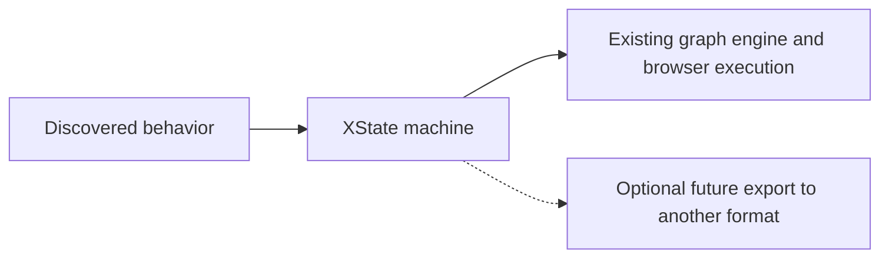
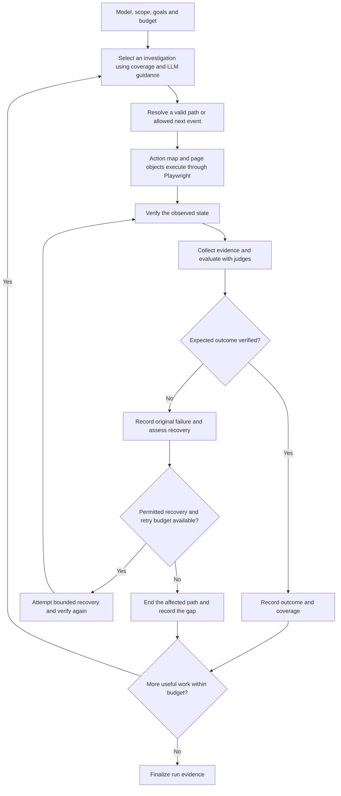
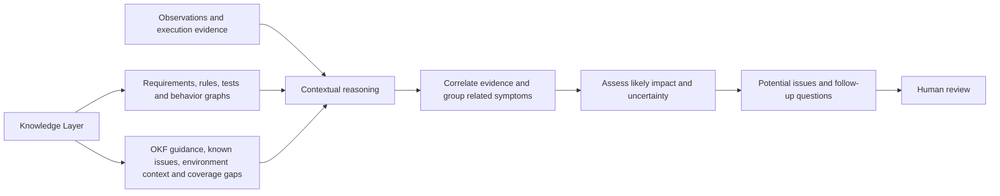
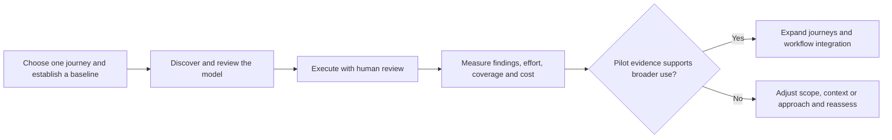
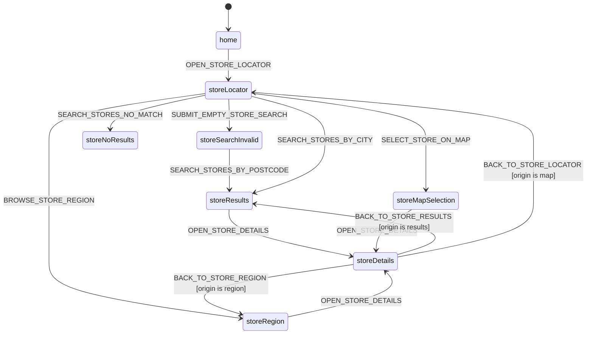

# Guided AI exploration for quality engineering

## Purpose and scope

This initiative aims to help QE teams understand application behavior, choose useful investigations and turn observations into evidence-backed potential issues. The QE practice discussion should test where the approach would be useful, how teams could adopt it and which assumptions need experiments.

The target outcome is guided AI exploration that produces useful, evidence-backed potential issues. “Guided” means that exploration follows a QE goal, uses relevant application knowledge and available behavior models, and operates within explicit scope, checks and budgets. Context awareness supports this capability. The current POC explores a graph-based implementation using XState and Playwright. Other implementations may achieve the same outcome with different tradeoffs. This document explains both the initiative and the POC without making the POC architecture a requirement for every future implementation.

## The idea in one minute

A QE engineer supplies an application scope, an investigation goal and relevant knowledge. The system discovers or reuses an understanding of the application, explores permitted behavior, evaluates observations and returns potential issues with evidence, reproduction details and uncertainty.

The Knowledge Layer provides relevant OKF material, requirements, existing tests, behavior graphs, domain information and reviewed findings. LLMs use that context to help choose investigations and assess results. Browser automation performs actions and verifies observable outcomes. QE reviews findings and directs follow-up work.

In the current POC, XState expresses observed behavior and Playwright executes paths through that model. Guided execution, recovery and an integrated Knowledge Layer are target capabilities still to be developed. The complete system and its productivity benefits have not yet been demonstrated.

## How to interpret the content

| Status            | Meaning in this document                                                                                       |
| ----------------- | -------------------------------------------------------------------------------------------------------------- |
| Demonstrated      | Supported by the inspected implementation or an earlier validation run; evidence applies to that scope and run |
| Target capability | An intended outcome of the initiative, not a claim of current implementation                                   |
| Proposed approach | A candidate design, use case or operating model that still needs evaluation                                    |
| Open question     | A choice that should be informed by practice feedback or experiments                                           |
| Illustrative      | A fictional scenario or output used to explain the intended experience                                         |

The role of OKF as a knowledge source is requested. Its full name, applicable contents and integration contract have not been established in this review. References to its use describe intended usage to validate with the source owner.

## 1. Why pursue this

The initiative addresses four practical QE problems.

| QE problem                                                                                     | Intended capability                                                      | Expected value to validate                                          |
| ---------------------------------------------------------------------------------------------- | ------------------------------------------------------------------------ | ------------------------------------------------------------------- |
| Understanding an unfamiliar application takes repeated manual investigation                    | Discover meaningful behavior and retain it as a reviewable model         | Faster orientation and a reusable description of user journeys      |
| Individual scripts make alternate paths and gaps difficult to see                              | Generate paths from a behavior graph and track modeled coverage          | More visible coverage of transitions, validations and return routes |
| A fixed execution plan may spend time on low-value paths or stop at a recoverable interruption | Guide exploration using risk, context, observations and bounded recovery | More useful investigation within a fixed time and cost budget       |
| Observations lack the context needed to judge their significance                               | Compare evidence with business expectations and known constraints        | Findings that are easier to triage and reproduce                    |

QE engineers retain responsibility for test strategy, expected behavior, acceptance decisions and finding confirmation. The system contributes exploration and evidence to that work. Existing regression suites remain useful for stable release checks; exploratory findings can become deterministic tests after review.

### Why this goes beyond a regression framework

A regression framework primarily asks whether known behavior still satisfies established checks. The target of this initiative is a broader investigation cycle: discover behavior, choose useful questions, collect evidence and interpret what happened using the Knowledge Layer.

| Dimension      | Regression testing emphasis                      | This initiative's target                                                              |
| -------------- | ------------------------------------------------ | ------------------------------------------------------------------------------------- |
| Starting point | Known scenarios and expected results             | An investigation goal, scope, available knowledge and an existing or discovered model |
| Selection      | Execute selected checks and report their results | Choose further investigations using risk, changes, coverage and observations          |
| Assessment     | Check results against encoded expectations       | Combine deterministic checks with evidence assessment and contextual reasoning        |
| Output         | Test results and regression evidence             | Potential issues, answered questions, coverage gaps and proposed knowledge updates    |

These capabilities can overlap with advanced testing platforms. XState or an LLM judge alone does not establish the distinction. The value to demonstrate is the complete discovery, investigation, evidence and reasoning loop. A run could pass its existing assertions while still exposing a concern those assertions do not address, provided that concern has an independent expectation and supporting evidence.

The current POC primarily demonstrates model-based execution, with semantic discovery and advisory evaluation. Guided investigation and the integrated Knowledge Layer remain target capabilities. The broader positioning should be validated through those capabilities and useful QE outcomes.

## 2. An illustrative investigation and its output

### Investigation flow

The following is an illustrative target scenario. The change, requirement, test data and suspected defect are fictional. It does not describe a defect found in the POC or an investigation the current system has completed.

The QE request is to investigate a changed brand filter in store lookup, focusing on combinations of postcode and brand within an approved test environment.

| Step                 | What happens in the target system                                                                                                                                     | Contribution to the investigation                                          |
| -------------------- | --------------------------------------------------------------------------------------------------------------------------------------------------------------------- | -------------------------------------------------------------------------- |
| Establish scope      | QE supplies the change description, permitted actions, approved data and a time budget                                                                                | A bounded question about search relevance                                  |
| Retrieve knowledge   | The Knowledge Layer supplies the search requirement, existing tests, lookup graph, representative store data and relevant OKF guidance                                | An expectation source and useful investigation techniques                  |
| Identify a gap       | Existing tests cover postcode search and a no-match brand case, but not a brand expected to match the selected postcode                                               | A missing combination worth investigating                                  |
| Prepare execution    | Reuse the locator and search adapters; review and extend the graph, inputs or assertions where the selected variation is not represented                              | An executable investigation that stays within the model and approved scope |
| Execute and observe  | Search the approved postcode without a brand, then with Brand A; in this fictional example, Store A disappears and the UI reports no results                          | Browser evidence for the suspected inconsistency                           |
| Assess evidence      | Deterministic checks confirm the selected inputs and visible outcome; judges assess available evidence against the relevant criteria                                  | A supported observation, with any evidence limits retained                 |
| Reason with context  | The requirement and approved data say Store A should match; a controlled repeat checks reproducibility, while environment limitations and known issues are considered | A potential issue rather than a conclusion based only on an empty result   |
| Review and follow up | QE verifies the data and behavior, confirms or rejects the finding, and proposes an appropriate test or knowledge update                                              | A reviewed outcome and a clear next action                                 |

The existing graph does not automatically cover every brand and postcode variation. The preparation step is necessary before claiming execution coverage for a new combination.

### Example of what a QE engineer receives

This sample deliverable uses the fictional scenario above. All identifiers and evidence references below are illustrative placeholders, not repository artifacts or real findings.

| Field                 | Example finding                                                                                                                                                                                              |
| --------------------- | ------------------------------------------------------------------------------------------------------------------------------------------------------------------------------------------------------------ |
| Title                 | Store lookup excludes an expected matching store when Brand A is selected                                                                                                                                    |
| Status                | Potential issue awaiting QE confirmation                                                                                                                                                                     |
| Investigation         | Assess postcode and brand combinations after the filter change                                                                                                                                               |
| Expected behavior     | Return Store A for approved Postcode P and Brand A, according to illustrative requirement `REQ-SEARCH-01` and domain dataset `STORE-DATA-01`                                                                 |
| Observed behavior     | Store A appears without a brand filter; selecting Brand A produces a no-results message                                                                                                                      |
| Knowledge references  | Applicable revisions of `REQ-SEARCH-01`, `STORE-DATA-01`, existing postcode test `TEST-SEARCH-01` and the reviewed lookup graph; OKF guidance informed variation selection                                   |
| Evidence              | `E1` records the baseline inputs and result; `E2` records the brand selection and no-results outcome; `E3` records a controlled repeat, together with the run's application, environment and model revisions |
| Possible impact       | Users seeking Brand A may conclude that no relevant store is available                                                                                                                                       |
| Confidence and limits | The behavior repeats for this one approved combination; the cause is unconfirmed, dataset freshness needs review and other brands or postcodes remain untested                                               |
| Recommended follow-up | Verify the domain data and feature configuration, then reproduce independently; if confirmed, raise a defect and add a focused regression check                                                              |

Reproduction steps for this illustrative finding are to open the store locator in the recorded test environment, search approved Postcode P with no brand selected, record Store A in the results, select Brand A, submit the search again and record the no-results outcome. The actual deliverable must include usable approved data or a resolvable fixture reference and links to retained evidence.

QE receives a claim that can be checked against its sources, with a reproducible path and explicit limits. Root cause, severity and confirmation remain review decisions supported by the investigation.

## 3. Candidate use cases

| Use case                                            | What a QE team supplies                               | What the target system does                                                | Useful output                                                     |
| --------------------------------------------------- | ----------------------------------------------------- | -------------------------------------------------------------------------- | ----------------------------------------------------------------- |
| Discover an unfamiliar or poorly documented journey | Entry point, allowed scope and representative data    | Explore meaningful actions and alternate outcomes                          | Behavior graph, executable adapters and open questions            |
| Investigate a changed feature                       | Existing model, change description and affected rules | Prioritize affected paths and report observed model differences for review | Evidence of regressions, coverage gaps and proposed model updates |
| Explore business-rule boundaries                    | Rules, valid and invalid data examples                | Exercise safe boundary and prerequisite variations                         | Observed validation behavior and suspected rule violations        |
| Explore role or environment differences             | Authorized roles and expected differences             | Execute comparable journeys under each permitted configuration             | Evidence-backed differences and unexplored combinations           |
| Investigate a suspected problem                     | A concern, reproduction hints and relevant context    | Reach the situation, explore related paths and collect evidence            | Reproduction details and related observations                     |
| Prepare reusable regression coverage                | A reviewed discovery model and stable expectations    | Generate repeatable paths and identify candidates for stronger assertions  | Model-based regression checks and a maintenance baseline          |

These are proposed applications of the target capabilities, not committed delivery scope or a claim that they are supported today. The first pilot should focus on one bounded web journey. The current browser stack is suited to observable UI behavior; performance, security, accessibility conformance and API correctness need their own techniques and evidence.

## 4. The target flow

**Status: target capabilities.** This flow describes what the initiative should accomplish independently of whether the implementation uses a graph.

| Stage                                | Purpose                                                              | Outcome                                                        |
| ------------------------------------ | -------------------------------------------------------------------- | -------------------------------------------------------------- |
| Discover or reuse behavior knowledge | Understand meaningful capabilities, actions and observed outcomes    | Reviewable application knowledge and explicit gaps             |
| Guided exploration                   | Choose and execute useful investigations within scope and budget     | Observed outcomes, judge assessments and any recovery attempts |
| Collection                           | Preserve what happened and the evidence available                    | A record that supports review and reproduction                 |
| Contextual reasoning                 | Compare observations with relevant expectations and domain knowledge | Potential issues and explanations with explicit uncertainty    |
| QE review                            | Confirm, reject or investigate findings and proposed updates         | An actionable decision and follow-up                           |

An explicit behavior graph is one way to retain and use application knowledge. A different implementation may organize that knowledge around goals, existing tests or another representation. All approaches need to explain their actions, findings and limits.

The proposed feedback process keeps raw evidence distinct from trusted expectations. Observations can motivate new investigations or knowledge changes, but do not automatically establish correct behavior.

## 5. The Knowledge Layer and context awareness

**Status: target capability; the retrieval and maintenance workflow below is a proposed approach.**

The Knowledge Layer is a shared architectural capability that supplies relevant, traceable knowledge to discovery, exploration, judges and reasoning. It brings together OKF, requirements, tests, behavior graphs, domain information and reviewed findings so each stage can use more than the currently visible page.

Context awareness is how that knowledge is used for a particular task. A context pack is the selected material for one journey or investigation. XState context has a separate role: it tracks small pieces of execution state, such as where a store details page was opened from.

### What the Knowledge Layer contains or references

| Knowledge source                         | Contribution                                                      | Example of usage                                                                            |
| ---------------------------------------- | ----------------------------------------------------------------- | ------------------------------------------------------------------------------------------- |
| OKF                                      | Relevant material available through OKF, subject to source review | Use applicable guidance to inform investigations once its scope and authority are confirmed |
| Requirements and acceptance criteria     | Intended behavior and explicit expectations                       | Check that empty search produces the required validation message                            |
| Existing tests, scenarios and assertions | Known checks, representative inputs and existing coverage         | Reuse useful search cases and identify missing filter combinations                          |
| Behavior graphs and journey models       | Observed states, transitions, guards and navigation relationships | Reach store details through results, a region or the map and investigate each return route  |
| Domain rules and representative data     | Business meaning and expected data relationships                  | Determine whether a store should match a postcode and brand                                 |
| User roles and personas                  | Relevant goals, priorities and permission expectations            | Investigate whether a visitor can find a store without signing in                           |
| Change scope and business priorities     | Where investigation is most valuable now                          | Prioritize search and filter combinations after a filter change                             |
| Known issues and reviewed findings       | Prior knowledge of problems and their disposition                 | Identify a recurring symptom and link it to an existing issue                               |
| Environment and feature configuration    | Conditions that affect what can run and what results mean         | Explain a feature intentionally disabled in the test environment                            |
| Prior run evidence and coverage          | What has been observed and what remains untested                  | Find return routes or input variations that lack evidence                                   |

These sources have different authority. Requirements describe intended behavior; graphs describe modeled behavior; tests encode selected checks; run evidence records observations. Applicable OKF material may inform investigations once its scope and authority are confirmed. An existing test or learned graph does not automatically establish correctness. Contradictions between sources need review.

The Knowledge Layer can reference artifacts where they already live. XState machines remain in the repository as the executable behavior models. This design does not require a duplicate graph or copying every source into one database. OKF connectivity, other source integrations, indexing, retrieval and storage remain implementation choices; they are not implemented capabilities claimed by this document.

### Proposed usage across stages

| Consumer               | Knowledge used                                                                                 | Result                                                                                                            |
| ---------------------- | ---------------------------------------------------------------------------------------------- | ----------------------------------------------------------------------------------------------------------------- |
| Discovery              | Existing graphs, requirements, tests and applicable OKF guidance                               | Focused candidates for exploration and explicit gaps; only observed transitions are added to the discovered graph |
| Exploration controller | Graph paths, risk, changes, test coverage and prior observations                               | A useful next investigation within scope and budget                                                               |
| Judges                 | Applicable acceptance criteria, domain rules and reviewable evaluation guidance                | An assessment linked to its expectation source, or an explicit evidence gap                                       |
| Recovery               | Known navigation paths, environment constraints and previously verified restoration procedures | A permitted recovery candidate that must be verified in the browser before continuation                           |
| Contextual reasoning   | Observations, requirements, domain data and known issues                                       | Potential issues with supporting evidence, expected behavior and uncertainty                                      |
| QE reviewer            | Source references, model revisions, execution evidence and prior decisions                     | Confirmation, correction, rejection or a follow-up question                                                       |

The proposed workflow starts with a QE-curated set of sources for the journey. The system selects relevant knowledge for each task instead of passing every project document to every LLM call. Context packs retain source references and revisions, and run records identify which knowledge informed their decisions. This supports review and reproduction when requirements or tests later change.

### Proposed knowledge maintenance

Knowledge needs a source, owner, applicable version, review status and known limitations. QE and domain owners curate expectations and resolve conflicting or stale material. Missing knowledge becomes a visible question or coverage gap, rather than an invented business rule.

Collection preserves raw observations as evidence. A failed check, LLM suggestion or apparent new behavior does not automatically become a trusted expectation. Reviewed discoveries can update graph references; confirmed findings can update known issues or tests; reusable lessons can be proposed for the appropriate knowledge source. Each update follows that source's ownership and review process. Known issues provide triage context without hiding observed failures. Application page content remains evidence to inspect, not instructions for the exploration agent.

The illustrative investigation in section 2 shows why these sources play different roles. The graph provides a route, tests show selected checks, requirements and domain data supply expectations, and observed results provide evidence. Missing or conflicting expectations should remain visible in the finding rather than being filled in by the LLM.

## 6. Implementation options and the graph-based experiment

**Status: the graph foundation is demonstrated; its extension into the complete target system is proposed. Alternative implementations are open questions.**

The POC uses an explicit graph because it can make states, allowed transitions and generated paths inspectable. It also provides a basis for tracking which modeled behavior has been exercised. The hypothesis is that this structure will support useful investigation, reproducibility and coverage visibility.

Those properties come with costs. A graph must be discovered, reviewed and maintained. Context and input combinations can increase the state space, and a model can omit important behavior or fall behind the application. Browser adapters and assertions also need maintenance. A graph does not establish correct business behavior or complete application coverage.

### Current graph foundation

The target extension adds context-guided investigation selection, bounded recovery, structured evidence and contextual reasoning. These are not demonstrated merely by generating more graph paths.

### Alternatives worth comparing

| Candidate approach                          | Rationale to test                                                                    | Tradeoff or question to investigate                                             |
| ------------------------------------------- | ------------------------------------------------------------------------------------ | ------------------------------------------------------------------------------- |
| Explicit behavior graph                     | Make paths, constraints and modeled coverage inspectable                             | Does the investigation value justify discovery and maintenance effort?          |
| Goal-driven agent using the Knowledge Layer | Select actions directly from an investigation goal and current observations          | How are action boundaries, reproducibility and investigation gaps made visible? |
| Exploration organized around existing tests | Reuse established scenarios, inputs and execution adapters                           | How well can it investigate behavior absent from those tests?                   |
| Hybrid                                      | Use explicit models for stable behavior and other guidance for less understood areas | Does combining approaches improve results enough to justify added complexity?   |

Only the graph foundation has been evaluated in this POC. The other rows are experiment candidates, not implemented systems or claims of better performance. Comparisons should use comparable journeys, knowledge, goals and budgets, then assess finding quality, reproducibility, coverage visibility, review effort, maintenance and cost.

## 7. Discovery in the current graph implementation

**Status: existing discovery workflow and output contract.**

This section and the following execution section explain the graph-based option. Their model and adapter contracts do not prescribe the implementation of the alternatives in section 6.

The current design uses `/semantic-app-discovery` to explore the application through Playwright MCP and produce XState directly.

Discovery starts with an application, an allowed scope, approved inputs and an exploration budget. It observes visible controls and content, groups interactions into business intents, and investigates meaningful outcomes. It returns to a recognized source situation before exploring another branch.

Only observed behavior belongs in the discovered model. A path that was blocked, unavailable or outside scope is reported as a gap. It is not assumed to work.

### Model representation and optional exports

In this POC, discovery produces a typed XState machine directly. A separate converter is unnecessary for that execution flow. A different implementation could choose a different representation.

Another format would be an optional future integration with a defined consumer and schema. YAML is a serialization format; it needs an agreed behavior schema before it can represent or execute the same semantics. The current discovery contract does not create YAML or a second persistent graph.

### The discovery deliverables

In the default integrated mode, discovery produces two cooperating parts.

| Deliverable                   | Responsibility                                    | Repository location                                      |
| ----------------------------- | ------------------------------------------------- | -------------------------------------------------------- |
| XState machine                | States, events, transitions, context and guards   | `src/machines/`                                          |
| Page objects                  | Browser locators, actions and state assertions    | `tests/support/pages/`                                   |
| Action map                    | Connect model events to browser behavior          | `tests/support/actions/`                                 |
| State verifier                | Connect model states to assertions                | `tests/support/pages/state-verifier.ts`                  |
| Fixture and project wiring    | Make the journey available to the test runner     | `tests/fixtures.ts` and `playwright.config.ts`           |
| Stub actions and journey spec | Validate path wiring and register generated tests | `tests/support/actions/stub-actions.ts` and `tests/mbt/` |

The machine remains independent of Playwright, selectors, URLs and environment configuration. Browser details live in adapters. An explicit model-only discovery run produces the machine proposal and lists the adapter work still needed.

## 8. Proposed guided execution for the graph option

**Status: proposed implementation of target exploration, judging and recovery capabilities.**

In the graph-based proposal, the graph constrains and informs exploration while an LLM helps select useful investigations. The selection can consider coverage gaps, business importance, previous observations and remaining budget.

The existing deterministic path engine remains useful for reproducible routes, broad transition coverage and regression checks. Guided execution adds decisions during the run, including how to respond when the browser outcome differs from expectations.

The controller enforces scope, allowed actions, budgets and stopping conditions. LLM suggestions must be checked against those constraints before execution.

### Judges and recovery

Deterministic checks verify concrete facts such as URLs, visible validation messages and required page elements. LLM judges assess evidence against a rubric and can identify concerns that those checks do not cover. A screenshot may not expose internal model context, so a judge must be able to report insufficient evidence.

Recovery should preserve the original failure and record every attempted corrective action. A successful recovery means execution found a verified way to continue. It does not erase the failure or establish that the application was correct.

Recovery has finite retry and time budgets. If the browser state cannot be recognized or restored reliably, the affected path ends with its evidence and coverage gap preserved.

These selection and recovery capabilities are target behavior. The current runner executes generated paths and stops on action or assertion failures; its optional LLM evaluation is advisory.

## 9. Collect observations and evidence

**Status: target capability; the record fields below are proposed.**

Collection gives later reasoning a dependable record of the run. It must include successful outcomes, failures, uncertain assessments, blocked paths and recovery attempts.

The target is a structured run record with stable references to evidence. Storage technology and the full schema remain to be selected.

| Information                                                        | Why it matters                                                     |
| ------------------------------------------------------------------ | ------------------------------------------------------------------ |
| Run, model revision, application version and environment           | Identify what was tested                                           |
| Knowledge source references, revisions and context pack used       | Explain which expectations and guidance informed the investigation |
| Journey, source state, event, intended target and relevant context | Explain what execution attempted                                   |
| Observed outcome and assertion result                              | Establish what actually happened                                   |
| Screenshots, logs, traces or other available evidence              | Support review and reproduction                                    |
| Judge verdict, criteria and uncertainty                            | Preserve the assessment and its limits                             |
| Recovery actions and verified outcomes                             | Explain divergence and continuation                                |
| Coverage, untested inputs and blocked candidates                   | Make the limits of the run visible                                 |

Observed facts and LLM interpretations should remain distinguishable. An unavailable screenshot or failed judge request is an evidence gap, not an application defect.

## 10. Reason with application and project context

**Status: target capability.**

The final reasoning stage combines observations with expectations. It asks whether the observed behavior could matter to a user or violate a documented rule.

Reasoning needs an expectation independent of the observation being assessed. The illustrative finding in section 2 compares the empty result with a requirement and approved domain data. If that expectation is missing or unreliable, the output should explain the uncertainty and what information would resolve it.

Each potential issue should include a clear description, the violated or suspected expectation, supporting evidence, reproduction steps, likely impact, confidence and relevant coverage limits. Related symptoms should be grouped so reviewers receive one supported concern rather than several duplicate reports.

This stage should distinguish likely application issues from adapter failures, environment problems, model gaps and judge uncertainty. Its output is a set of reviewable findings, with confirmation status explicit.

## 11. Technology stack and responsibilities

| Technology or component                  | Responsibility                                                                                                    | Current position                                                                     |
| ---------------------------------------- | ----------------------------------------------------------------------------------------------------------------- | ------------------------------------------------------------------------------------ |
| TypeScript on Node.js with ESM           | Typed models, graph engine, adapters and evaluation code                                                          | Existing foundation                                                                  |
| XState v5                                | Executable behavior models, context and guards                                                                    | Existing model format                                                                |
| `xstate/graph`                           | Path generation and graph traversal                                                                               | Existing graph foundation                                                            |
| Playwright Test                          | Browser execution, fixtures, assertions, attachments and reports                                                  | Existing execution foundation                                                        |
| Playwright MCP                           | Browser observation and interaction during agent discovery                                                        | Used by the discovery skill                                                          |
| Claude running `/semantic-app-discovery` | Current agent workflow for semantic discovery and repository integration                                          | Used for store lookup discovery                                                      |
| LLM gateway and rubric evaluators        | Assess step and route evidence and synthesize observations                                                        | Existing optional evaluation; current configuration supports `gpt-4o-mini`           |
| Guided exploration controller            | Combine model constraints, coverage, LLM decisions and recovery                                                   | Planned extension                                                                    |
| Structured evidence collection           | Preserve correlated observations and artifacts for later analysis                                                 | Planned extension of current attachments and reports                                 |
| Knowledge Layer                          | Supply relevant OKF knowledge, requirements, tests, graphs and reviewed findings with traceable source references | Target capability; source integration and retrieval technology remain to be selected |
| Contextual reasoning layer               | Interpret evidence using relevant Knowledge Layer material                                                        | Planned extension of current observation synthesis                                   |
| Markdown and Mermaid                     | Explain behavior, architecture and results                                                                        | Documentation format                                                                 |

Provider portability and future model selection are open design questions. The current evaluator restricts the configured model to `gpt-4o-mini`; it does not demonstrate interchangeable provider support. Knowledge retrieval, storage and integrations are also undecided.

## 12. Demonstrated foundation and remaining work

| Area                | Current state                                                                                                         | Target state                                                                                                                                       |
| ------------------- | --------------------------------------------------------------------------------------------------------------------- | -------------------------------------------------------------------------------------------------------------------------------------------------- |
| Semantic discovery  | A skill produces XState and, by default, Playwright wiring                                                            | Repeatable discovery with explicit scope, observed behavior and reported gaps                                                                      |
| Model format        | Pure typed XState machines                                                                                            | XState is the executable source of truth for the graph-based option; whether an explicit graph is the best approach remains an experiment question |
| Knowledge Layer     | Models, tests and documentation exist as separate artifacts; no integrated Knowledge Layer is established in this POC | Relevant OKF, requirements, tests, graphs and reviewed findings supplied across stages with source and revision traceability                       |
| Execution selection | Deterministic generated paths; a separate coverage loop is available and tested in stub mode                          | Guided LLM exploration combined with deterministic traversal and coverage goals                                                                    |
| Browser execution   | Action maps, page objects and state assertions                                                                        | Reuse these adapters for guided execution                                                                                                          |
| Judges              | Optional advisory step and route evaluation                                                                           | Judges integrated with exploration decisions while preserving uncertainty                                                                          |
| Recovery            | No recovery hook in the current path runner                                                                           | Bounded recovery with state recognition, verification and complete attempt history                                                                 |
| Collection          | Test attachments, per-test observations and a suite Markdown report                                                   | Structured correlated evidence usable across paths and runs                                                                                        |
| Reasoning           | Observation synthesis from test evidence and judge assessments                                                        | Contextual analysis using project expectations, evidence correlation and issue deduplication                                                       |
| Findings            | Advisory concerns, errors and coverage gaps                                                                           | Prioritized, reproducible potential issues with explicit confirmation status                                                                       |

The store lookup journey has been validated through 17 generated transition paths in both stub and live application modes. That establishes executable coverage of those modeled paths for that run. Discovery completeness, other input variations and future application changes remain separate questions.

The current suite observation report is written to `artifacts/llm-observations/llm-judge-suite-observations.md` when observation reports are available. It is a useful starting point for collection and reasoning, but it does not yet provide the full contextual analysis described here.

## 13. Adoption in a QE team

Adoption should begin with a useful, bounded problem and expand based on measured results. The following is a proposed adoption path, not a delivery schedule.

| Adoption step                               | Team activity                                                                                                                 | Evidence needed to proceed                                                         |
| ------------------------------------------- | ----------------------------------------------------------------------------------------------------------------------------- | ---------------------------------------------------------------------------------- |
| Select a pilot                              | Choose a stable test environment, bounded journey, owner, approved data and investigation goal                                | A clear question worth answering and an existing approach to compare against       |
| Prepare the Knowledge Layer                 | Identify applicable OKF material, requirements, existing tests, graphs and domain context; assign owners and record revisions | A reviewed context pack with traceable expectations and explicit missing knowledge |
| Establish a baseline                        | Record current exploration effort, useful findings and known coverage                                                         | A consistent basis for evaluating benefit                                          |
| Review discovery                            | Check whether the model represents meaningful behavior and whether assertions are valid                                       | A reviewed model, executable paths and visible gaps                                |
| Evaluate the available POC                  | Run existing model-based checks and advisory judges alongside normal QE work                                                  | Reproducible outputs and a record of manual review effort                          |
| Pilot target capabilities as they are built | Introduce context-guided selection, structured evidence and bounded recovery incrementally                                    | Each addition improves a defined measure without obscuring failures                |
| Expand and integrate                        | Add journeys, context sources, reporting and selected CI execution                                                            | Clear ownership, acceptable operating cost and sustained finding quality           |

Under the proposed ownership model, QE owns exploration goals, Knowledge Layer curation, model review and triage. Application or product specialists help resolve domain expectations. Automation engineers maintain adapters and execution integration. The practice can contribute applicable OKF knowledge, reusable rubrics, context templates, evaluation methods and adoption guidance. The exact split should fit the team.

Initial runs should support investigation and human decisions. Any future CI gate based on LLM assessments needs separate evidence of reliability and an agreed failure policy. Stable deterministic paths can enter existing regression workflows through normal review.

### How to measure whether it helps

| Measure                       | What to capture                                                                                       |
| ----------------------------- | ----------------------------------------------------------------------------------------------------- |
| Time to useful coverage       | Time to the first reviewed executable journey, including context preparation and model corrections    |
| Finding quality               | Human-confirmed useful findings, false positives, duplicates and inconclusive reports                 |
| Investigation value           | Useful findings or answered questions compared with a QE baseline on comparable scope and time budget |
| Coverage quality              | Meaningful transitions and input variations exercised, plus known discovery gaps                      |
| Review and maintenance effort | Time spent on triage, context updates, adapter repair and model changes                               |
| Reproducibility               | Whether a reviewer can replay a finding and observe the reported outcome                              |
| Operating cost                | Browser runtime, LLM usage and total effort per useful investigation                                  |
| Recovery quality              | Attempts, verified resumptions and whether original failures remain visible                           |

The team should agree success thresholds before the pilot. Path counts and LLM verdict counts alone are insufficient measures of quality. Missed defects need a reference, such as seeded issues or an independently reviewed baseline, before a detection-rate claim is possible.

## 14. What success means for the initiative

**Status: target outcomes; pilot thresholds remain to be agreed.**

For an agreed application scope, the initiative should support a complete investigation cycle.

1. Discover or reuse meaningful application knowledge and report what remains unexplored.
2. Make the selected investigations executable and their actions reviewable.
3. Use relevant knowledge and observations to guide exploration within explicit scope and budgets.
4. Evaluate outcomes and attempt bounded recovery when appropriate, retaining original failures.
5. Preserve evidence and enough context to support reproduction.
6. Reason about observations using applicable expectations and knowledge sources.
7. Deliver potential issues, answered questions and gaps that QE can review and act on.

XState is one implementation of this cycle, not a success criterion for the initiative. Alternative approaches should be assessed against the same outcomes and operating constraints. Benefits such as reduced effort or better finding quality require comparative evidence.

## 15. Feedback sought from the QE practice

The forum should help test the initiative's usefulness and shape its next steps. The following questions are intended to produce decisions and concrete examples.

### Open question: is graph-based exploration the best implementation?

The graph-based approach is one candidate. Section 6 describes alternatives and the tradeoffs to test. The practice should help select which approaches to compare and where an explicit graph may add more cost than value. The choice should follow experiment results.

| Discussion topic            | Question for the practice                                                                                                                     | Desired outcome                                          |
| --------------------------- | --------------------------------------------------------------------------------------------------------------------------------------------- | -------------------------------------------------------- |
| Value                       | Which recurring QE task would benefit most, and where would this add little value?                                                            | A prioritized problem and explicit limits                |
| Implementation alternatives | Would an explicit graph, goal-driven agent exploration, an approach based on existing tests, or a hybrid work best for the selected use case? | Candidate approaches and a fair comparison experiment    |
| Pilot                       | Which real journey has suitable access, test data and an owner willing to evaluate it?                                                        | A pilot candidate and accountable team                   |
| Knowledge Layer             | Which OKF material, requirements, tests, graphs and domain data should be used, and who maintains them?                                       | A minimum context pack, source owners and review process |
| Trust                       | What evidence would make a finding actionable, and what noise is acceptable?                                                                  | Review criteria and pilot success thresholds             |
| Human involvement           | Which decisions should remain with QE, and which can be delegated?                                                                            | Agreed review points and execution boundaries            |
| Workflow                    | Where should models and findings fit into existing exploration, regression and triage?                                                        | Integration priorities                                   |
| Gaps                        | What failure modes or missing capabilities would prevent adoption?                                                                            | Ranked risks and experiments                             |

A useful session closes with one candidate use case, the context needed to evaluate it, candidate implementation approaches, agreed success measures and owners for the next experiment. Capture disagreements and unanswered questions as feedback rather than presenting them as settled design decisions.

## 16. Proposed deck format and topics

**Status: proposed presentation structure.** Thirteen slides including the opening and two demo transition slides, grouped into five topics. Explain the initiative and gather QE practice feedback.

### Content and readability standard

The deck must read well without the presenter. Each slide needs a clear main message and enough explanation for a QE reader to understand what happens, why it matters and how it connects to the next stage. Simplicity means clear structure and plain language, not removing essential information.

Use the pre-simplification deck as the reference for explanatory depth and structured content, while following the current slide sequence and content boundaries below. Preserve meaningful explanations and relationships. The desired result is a complete, readable presentation, not a set of sparse prompts for the presenter.

Simplify the expression of an idea: use familiar wording, direct diagrams and a clear reading order. Do not introduce extra stages, terminology, layers or decision branches merely to make a straightforward mechanism look sophisticated. A simple mechanism can be explained directly; a mechanism with several meaningful parts should retain those parts and explain their relationship.

Retain the substantive explanation of capabilities, mechanisms, context usage, controls, tradeoffs and maturity. Diagrams need short descriptions of their steps and decisions; headings and arrows alone are insufficient. The content listed below belongs on the slides. Narration may expand it with examples and the demo, but must not supply the only explanation of a concept.

Use readable diagrams, short paragraphs, bullets or compact comparisons as appropriate. Avoid oversized empty cards, isolated labels and excessive whitespace that displaces explanation. There is no fixed word quota. Keep the content hierarchy clear and remove repetition before removing meaning.

One main message per slide does not mean one sentence per slide. Supporting explanation, useful comparisons and necessary qualifications should remain visible. Use narration for elaboration and application-specific examples, not to fill gaps in the slide's basic explanation.

Keep the previous decisions: discovery and guided exploration are distinct phases; the Knowledge Layer supports their flows; graph-based and agentic implementations remain open to experimentation. Two minimal demo transition slides mark where to switch to the repository and browser. Demo-specific details belong in those walkthroughs, not in the slide content. Constructed defect scenarios and adoption commitments remain outside the main deck.

### Consistent status labels

Use the following exact labels throughout the deck. They align with the document's status definitions while describing the POC in language suitable for the presentation.

| Label                  | Meaning                                                                                                                   | Examples                                                                                                          |
| ---------------------- | ------------------------------------------------------------------------------------------------------------------------- | ----------------------------------------------------------------------------------------------------------------- |
| **Current foundation** | Exists in the inspected POC, within its implemented scope. This does not establish completeness or measured benefits.     | Discovery workflow, XState models, Playwright execution, deterministic state checks, optional advisory LLM judges |
| **Target capability**  | An intended capability that is not yet fully implemented or validated. It does not commit to a particular implementation. | Adaptive investigation selection, bounded recovery, integrated knowledge retrieval, contextual reasoning          |
| **Proposed approach**  | A candidate implementation or operating approach that needs experimentation.                                              | Lightweight agentic executor, a particular recovery policy, alternative graph or hybrid designs                   |

Do not introduce interchangeable badges such as **Proposed**, **Proposed option**, **Available now** or **Proposed · candidate use cases**. Use **Proposed approach** for an implementation option and **Target capability** for the intended behavior it would enable. “Candidate use cases” describes applications of the capabilities, not a separate status. Keep “optional” and “advisory” in the explanation of current judges rather than treating them as status labels.

Apply a label to the relevant content, not automatically to an entire slide. A slide can combine current and target elements if each is clearly identified. Use one label for a group with the same status rather than repeating badges on every item. Problem statements and general explanations do not need status badges. Retain the existing capability names and slide titles; status labels supplement them.

### Opening

#### Slide 1. Guided AI exploration for quality engineering

**Main message:** An initiative to discover application behavior, guide useful exploration and reason about the evidence.

**Include on slide:** The title and subtitle, “Target capabilities, early POC evidence, and open questions.” The opening establishes the subject and purpose; it does not need a feature inventory.

### Topic 1. Why this initiative

Explain the QE problem, the proposed response and the intended value.

#### Slide 2. The QE investigation problem

**Main message:** The initiative addresses repeated investigation effort, difficult-to-see coverage gaps, execution limitations and observations that need context. The expected value remains a set of hypotheses to validate.

**Layout reference:** Restore the original three-column structure, using the headings **QE problem**, **Target capability** and **Hypothesis to validate**. Keep the connection between the problem, the intended capability and its expected value visible in each row.

**Include on slide:**

| QE problem                                                                               | Target capability                                                   | Hypothesis to validate                                              |
| ---------------------------------------------------------------------------------------- | ------------------------------------------------------------------- | ------------------------------------------------------------------- |
| Understanding unfamiliar behavior requires repeated investigation                        | Discover behavior and retain a reviewable model                     | Reusing that knowledge reduces repeated discovery effort            |
| Alternate paths and gaps are difficult to see in individual scripts                      | Make modeled paths and coverage gaps visible                        | QE can identify relevant behavior that existing checks do not cover |
| Fixed execution may spend time on less useful paths or stop at recoverable interruptions | Guide execution using observations, priorities and bounded recovery | More useful investigation can be completed within the same budget   |
| Observations lack the context needed to assess significance                              | Compare evidence against relevant expectations                      | Potential issues become easier to reproduce and triage              |

Use **Hypothesis to validate**, not “Benefits to evaluate,” as the column heading. These are expected outcomes to test, not measured results or guaranteed improvements. It is an explanatory heading, not an additional maturity label. The **Target capability** column describes the intended response, not a claim that every capability is implemented.

Keep a short footer explaining that QE retains responsibility for expected behavior, acceptance decisions and finding confirmation. Preserve the explanatory content of the rows rather than reducing them to isolated problem or benefit labels.

#### Slide 3. How guided exploration complements regression testing

**Main message:** Regression testing checks established expectations. Guided exploration investigates questions and gaps, using existing tests and contributing new checks after QE review.

**Include on slide:** A compact comparison that explains the complementary roles.

| Aspect              | Regression testing emphasis                              | Guided exploration target                                                   |
| ------------------- | -------------------------------------------------------- | --------------------------------------------------------------------------- |
| Main question       | Does known behavior still meet established expectations? | What needs investigating, and what might existing checks miss?              |
| Investigation scope | Established scenarios and assertions                     | Relevant gaps, alternate paths and input variations                         |
| Assessment          | Encoded checks and expected outcomes                     | Checks plus evidence assessment and reasoning against relevant expectations |
| Useful output       | Results for established checks                           | Potential issues, unresolved questions and proposed coverage improvements   |

Explain how the two activities work together, alongside or below the comparison:

- Existing tests, requirements and previous findings inform exploration.
- Exploration can reuse browser actions and checks from existing automation where compatible.
- QE confirms potential issues and can turn the findings into focused regression tests.

Keep a short qualification visible: these are different emphases, not rigid categories. Regression platforms can include adaptive capabilities, and exploration still needs reliable checks. This describes the target relationship, not a claim that automated test reuse or finding-to-test generation is already implemented.

Label the guided exploration side **Target capability**. Regression testing is comparison context and does not need a POC status label.

Use the comparison and a short explanation of the feedback into regression as the main structure. Avoid a separate diagram that repeats the table, claims of replacing regression testing or implied productivity gains.

### Topic 2. Target capabilities and use cases

Connect the target capabilities to useful QE scenarios, showing what QE supplies, what the system does and what QE receives.

#### Slide 4. Target capabilities and use cases

**Main message:** Discovery, guided investigation and validation exploration support different QE needs, with clear inputs, activities and useful outputs.

**Layout reference:** Preserve the original three-column layout from slide 4 of the [original deck](../Design.pdf). Use one column per use case, with the same three visible sections: **QE supplies**, **System does** and **QE receives**. Keep the meaningful explanation in each section. Do not replace this layout with a table, sparse outcome-only cards or a separate feature inventory.

**Include on slide:**

- **Discover an unfamiliar journey**
  - **QE supplies:** Entry point, allowed scope and representative data.
  - **System does:** Explores meaningful actions, alternate outcomes and validations.
  - **QE receives:** A reviewable behavior model, reusable execution support and open questions.
- **Investigate a changed feature**
  - **QE supplies:** Existing behavior knowledge, the change description and affected rules.
  - **System does:** Uses that context to prioritize affected paths and input variations and identify behavior differences for review.
  - **QE receives:** Evidence of potential regressions, coverage gaps and proposed model updates.
- **Explore business-rule boundaries**
  - **QE supplies:** Applicable rules and approved valid and invalid data examples.
  - **System does:** Exercises permitted boundary and prerequisite variations against relevant expectations.
  - **QE receives:** Observed validation behavior and potential rule violations.

Use **Target capability** as the shared status label and “Candidate use cases” as descriptive text if needed. Do not combine them into a badge such as “Proposed · candidate use cases” or imply that every use case is implemented. Explain how the system contributes between the input and output; the later slides describe the mechanisms in more detail.

### Topic 3. Initial discovery

Explain how the agent learns meaningful behavior and prepares executable support.

#### Slide 5. Initial discovery flow

**Main message:** Discovery combines a scoped request, relevant knowledge and a repeatable agent workflow to observe behavior and prepare executable support.

**Layout reference:** Retain the original slide's inputs, Knowledge Layer and numbered discovery sequence. Make the step labels clearer and add the implementation explanation without replacing the sequence with generic request/workflow/tool boxes.

**Input area:** Use two compact bands above the flow so the original inputs remain visible without repeating them in separate cards.

- **Request pattern:** “Discover [journey] in [application], within [allowed scope], using [approved inputs], with [exploration budget].” This covers the application, scope, approved test data and execution limits.
- **Supporting knowledge / Knowledge Layer:** Existing graphs or models, requirements, tests, domain information and applicable OKF material. Keep this knowledge input distinct from the request parameters and workflow instructions.

**Implementation context:** Include a short explanation that the **Semantic App Discovery workflow** guides an agent using **Playwright MCP**. Workflow references provide modeling, browser interaction and output rules; application knowledge supplies relevant expectations. Use descriptive names such as workflow, skill or agent where appropriate, without displaying slash commands or file paths.

**Numbered flow:** Preserve six clear steps with enough explanation to read independently.

1. **Observe the current application state:** Read the browser and identify the meaningful application state.
2. **Choose an unexplored action:** Select a relevant, permitted action within the requested scope.
3. **Perform the action:** Use the browser tool with approved inputs.
4. **Inspect the outcome:** Identify the resulting application state, validation feedback or other meaningful change.
5. **Propose model and browser actions:** Capture observed behavior and the interactions and checks needed to execute it.
6. **Review and validate:** Review proposed changes, apply them and verify the executable output; preserve unsupported or unexplored areas as gaps.

Show that the flow repeats while useful permitted candidates remain within budget, returning to a recognized application state before exploring another branch. End with one handoff line: **behavior model + reusable browser actions and checks + known gaps**.

Use the request band, knowledge band and numbered flow as the main structure. Place the implementation explanation close to the flow, with enough room to read it rather than adding a competing diagram. Integrated Knowledge Layer retrieval remains a target capability; its presence as a supporting input does not establish that integration today.

Label the existing discovery workflow **Current foundation**. Label integrated Knowledge Layer retrieval **Target capability** without implying that supplying curated knowledge requires that future integration.

#### Slide 6. Discovery output: behavior model, actions and checks

**Main message:** Discovery records how the application behaves and prepares reusable browser actions and checks for further exploration.

**Status label:** **Current foundation**, limited to the existing discovery output contract and POC execution support.

**Include on slide:** Two connected sections explaining how the model relates to browser execution.

**Behavior model: what can happen**

- **Application states:** Meaningful conditions the application can be in. A state need not be a separate screen.
- **Actions and transitions:** What the user can do and which state can follow.
- **Conditions:** When a transition is available.

**Browser actions and checks: how to execute it**

- Playwright actions perform the interactions described in the model.
- Deterministic state checks verify that the expected application state was reached.
- Guided exploration uses this support to execute selected paths. The current runner executes graph-generated paths; adaptive selection remains a target capability.

Make the connection explicit: modeled actions connect to reusable browser actions, and modeled states connect to checks that recognize the outcome. Use **Application states**, not “User situations,” in the slide labels.

A readable XState screenshot may illustrate the behavior model, with the execution explanation alongside it. Use the caption: “The graph describes behavior. Browser actions perform it; checks verify the observed outcome.” Preserve the model's meaning and avoid highlighting a demo path or describing particular application outcomes. The image supports the explanation; it should not be the slide's only information.

Keep **Explored scope and known gaps** as a short footer identifying unresolved or unsupported areas. A model does not by itself prove application correctness or complete coverage. Use one **Current foundation** label for the implemented output rather than separate status badges on every element.

Use an authentic graph image when available. Do not export an empty upload area or image placeholder. If the image is unavailable, use a clearly explanatory diagram linking the model to browser actions and checks, without inventing application behavior. The slide should make the handoff from discovery to guided exploration understandable without narration.

#### Slide 7. Demo: discovery output and Playwright integration

**Main message:** Discovery produces a behavior model connected to reusable browser actions and deterministic state checks.

**Status label:** **Current foundation**.

**Include on slide:** The title and one short description, “Generated XState model and its connection to Playwright actions and checks.” This is an intentional transition to the demonstration, not an empty media placeholder or a slide of implementation details.

**Walkthrough scope:** Show the generated graph and use the repository to explain how modeled actions connect to browser actions and modeled states connect to checks. Focus on the artifacts and their relationship. Leave the full execution run for the second demo; do not duplicate it here. Keep file paths, code identifiers and application-specific output in the walkthrough rather than on the slide.

**Transition to guided exploration:** “We can represent behavior and execute paths through it. The target is to guide which investigations to run next using goals, context and observations.” Distinguish the demonstrated foundation from adaptive investigation selection, which remains a target capability.

### Topic 4. Guided exploration and reasoning

Explain how goals, available knowledge and observations guide execution and interpretation.

#### Slide 8. Guided exploration execution loop

**Main message:** The target executor uses feedback from each action to decide what useful permitted action should happen next.

**Status label:** **Target capability** for the adaptive loop. Label the current execution and candidate implementation separately as described below.

**Include on slide:** A loop whose stages have short explanations.

- **Select an investigation:** Prioritize a useful supported path or input variation using the exploration goal, coverage gaps, relevant context and previous observations.
- **Execute:** Perform the action through reusable browser interactions.
- **Observe and assess:** Read the actual outcome, run state checks, collect evidence and obtain relevant judge assessments.
- **Decide:** Continue, adjust the route, request bounded recovery or stop based on the outcome and remaining limits. Draw a visible feedback arrow to the next selection.

Show the goal, model and execution support, relevant context, scope and budget as inputs. Explain that evidence is retained throughout and that unsupported actions or exhausted budgets can end progress.

Keep a short implementation explanation on the slide: the current foundation executes graph-generated paths through browser automation. A proposed lightweight agentic executor could adapt decisions using the same model, actions and checks. These can coexist. Dynamic selection and recovery remain target capabilities; current LLM evaluation is advisory.

For the current implementation box, use the heading **“Graph-based paths through browser automation.”** Use **Current foundation** as its small status label, not the box title. Retain the explanation: deterministic, reproducible routes and broad transition coverage; the POC uses XState and Playwright. Label the lightweight agentic executor **Proposed approach**. The adaptive capability is the target; this executor is one possible implementation.

A diagram alone with “select an investigation, execute, observe, decide” is not sufficient. The reader should understand what informs selection and how observations affect continuation.

#### Slide 9. State checks, judges, and recovery

**Main message:** Different mechanisms verify outcomes, assess evidence and handle divergence.

**Include on slide:** A concise explanation of each responsibility, with maturity indicated.

- **Deterministic state checks** (**Current foundation**): Verify observable facts such as expected navigation, validation messages and required page elements. The current runner stops on action or assertion failures.
- **Evidence-based LLM judges** (**Current foundation**): Assess step or path evidence against defined criteria and surface concerns beyond existing checks. These assessments are optional and advisory today. Insufficient evidence must remain explicit; a screenshot may not expose everything needed to judge an outcome.
- **Recovery** (**Target capability**): Attempt a permitted corrective action within retry and time limits, then verify a recognized state before continuing. Stop when restoration cannot be verified. The detailed recovery policy remains a proposed approach.

Keep the principle “Recovery preserves the original failure and the record of corrective actions” visible. A successful continuation does not establish that the application was correct.

Restore these explanations rather than presenting three responsibility labels inside mostly empty columns. Detailed retry policy and rubric definitions can remain in reference material.

#### Slide 10. Demo: current XState-driven execution

**Main message:** The current runner executes graph-generated paths through Playwright, verifies application states and retains available execution evidence.

**Status label:** **Current foundation**.

**Include on slide:** The title and one short description, “Graph-based browser execution, deterministic state checks and collected evidence.” Keep this as a transition to the run rather than a report of demo results.

**Walkthrough scope:** Show the current XState-driven execution, browser actions, state checks and resulting attachments or report. If LLM evaluation is enabled and available for the run, show it as optional and advisory; do not imply it ran otherwise. This demonstration shows execution, while the first demonstration explains the generated artifacts and their integration.

Make clear that the run does not demonstrate adaptive investigation selection, implemented recovery or the complete contextual reasoning capability. Keep application inputs, navigation details, execution statistics and report contents in the demonstration rather than on the slide.

**Transition to reasoning:** Execution produces observations and evidence. The next slide explains the target capability for interpreting them against relevant expectations; a completed path or passing check does not by itself establish application correctness.

#### Slide 11. Evidence collection and contextual reasoning

**Main message:** Observations become potential issues only when assessed against relevant expectations and supporting evidence.

**Include on slide:** A flow with meaningful descriptions of its inputs, reasoning and output.

- **Evidence:** Actions taken, expected and observed outcomes, screenshots or logs where available, and relevant run context.
- **Knowledge Layer input:** Applicable requirements, tests, graphs, domain rules, known issues and relevant OKF material. Sources play different roles; observed behavior is not automatically the expected behavior.
- **Reasoning:** Compare evidence with expectations, relate observations and distinguish potential application issues from execution problems, model gaps and uncertainty.
- **QE output:** Potential issues, coverage gaps or unresolved questions, with evidence references, reproduction information and explicit confidence or limits.

Show QE review as the next step. State that evidence gaps lead to uncertainty or follow-up, rather than an invented business rule or a definitive defect claim. Integrated knowledge usage and deeper reasoning remain target capabilities.

Label existing observation collection and reporting **Current foundation**. Label integrated knowledge usage and deeper contextual reasoning **Target capability**. Do not mark the complete flow as implemented merely because reporting exists.

Keep this explanation on the slide. Actual reports and populated application findings remain in the demo.

### Topic 5. Current progress and open questions

Make maturity understandable and invite feedback on value, gaps and implementation choices.

#### Slide 12. Current foundation and remaining capabilities

**Main message:** A working execution foundation exists, while the complete guided investigation cycle remains to be developed and evaluated.

**Include on slide:** Two groups with brief descriptions, not capability names alone.

| Current foundation                                                              | Target capability                                                              |
| ------------------------------------------------------------------------------- | ------------------------------------------------------------------------------ |
| Discovery workflow that produces observed behavior models and executable wiring | Guided decisions that choose and adapt investigations during execution         |
| Graph-based models and paths executed through browser actions and state checks  | Bounded recovery that verifies continuation while preserving failures          |
| Optional advisory step/path evaluation and observation reporting                | Integrated knowledge usage and deeper contextual reasoning across observations |

Keep a note that useful finding quality and productivity benefits have not yet been established. This is a capability comparison, not a report of a particular demo run.

Use **Current foundation** and **Target capability** as the two group labels. Explain that the target group remains to be developed or evaluated without introducing another status category.

#### Slide 13. Implementation alternatives and practice feedback

**Main message:** The practice can help identify useful applications, missing capabilities and implementation experiments.

**Include on slide:** Focused questions with enough context to guide a reader's response.

- **Where is this useful?** Which QE investigations would benefit from reusable behavior knowledge, guided execution and contextual reasoning?
- **What is missing?** What expectations, evidence or capabilities would make the outputs useful and trustworthy?
- **What approaches should we try?** An explicit graph, lightweight agentic execution, reuse of existing tests or a hybrid may suit different needs. Graphs and agents can also work together; the choice needs experiments.

The outcome sought is feedback and candidate experiments, not adoption commitments or rollout decisions. Keep alternatives visible as discussion context without turning the slide into a detailed architecture comparison.

Use **Proposed approach** for candidate implementation descriptions. Keep unresolved choices as discussion questions rather than labeling all alternatives as target capabilities.

### Shared content boundaries and final check

Keep application-specific prompts, navigation paths, inputs, browser outcomes, execution statistics, generated reports and defect narratives in the demonstrations and spoken explanation. The two demo transition slides identify the walkthrough topics without displaying those details or claiming results. The worked scenario elsewhere in this document must not populate the deck. An XState screenshot may show incidental application labels without highlighting demo results.

Retain technical names where they explain the mechanism, but keep code identifiers, file inventories and test-mode details in reference material. Use small maturity labels where they affect interpretation. Do not invent results, business rules or measured benefits.

Name skills, workflows and agents descriptively in the deck, such as “Semantic App Discovery workflow” or “Semantic App Discovery skill.” Repository slash commands and exact invocation syntax belong in technical reference material rather than slide titles, labels or body text.

Before export, read the slides without speaker notes. A reader should understand the purpose, the two phases, their handoff, how execution is guided, how outcomes are assessed, what context contributes, and what exists versus remains planned. Restore missing explanations in the slide content instead of relying on narration. The demonstrations supplement the explanatory slides rather than supplying their missing content. Remove empty media placeholders while retaining the two intentional demo transition slides. Check readability without shrinking text to fit unnecessary repetition.

## Appendix A. Core concepts

| Concept         | Meaning                                                                             | Store lookup example                                                         |
| --------------- | ----------------------------------------------------------------------------------- | ---------------------------------------------------------------------------- |
| Journey         | A coherent user capability represented by a model                                   | Find a store and inspect its details                                         |
| State           | A stable user situation that can be recognized and checked                          | Search results are visible                                                   |
| Event           | A meaningful user intent                                                            | Search by postcode                                                           |
| Transition      | The observed result of an event from a particular state                             | Store locator becomes search results                                         |
| Model context   | Small pieces of execution state used by the machine                                 | Whether store details were opened from results, a region or the map          |
| Project context | Expectations, domain knowledge and constraints used to guide and assess exploration | Which stores should match a query and which journey matters most             |
| Knowledge Layer | Shared access to relevant, traceable QE and application knowledge                   | OKF guidance, search requirements, existing tests and the store lookup graph |
| Guard           | A condition that determines whether a transition is allowed                         | Return to a region only when details were opened from that region            |
| Path            | A sequence of events through the model                                              | Open locator, search, open details, return to results                        |
| Coverage        | The modeled states or transitions exercised by a run                                | All three modeled return routes were tested                                  |
| Judge           | A component that evaluates an action, state or path using defined criteria          | Assess whether the visible result supports the expected outcome              |
| Recovery        | A bounded attempt to regain a recognized state after execution diverges             | Dismiss an overlay, verify the page, then resume                             |
| Observation     | A recorded fact or assessment from execution                                        | Empty search displayed a validation message                                  |
| Potential issue | An evidence-backed concern that needs confirmation                                  | A valid search input returned an unexpected empty result                     |

A state does not have to be a separate page. The same store locator page can show a validation error, results or no results. Those situations can require different checks.

Equivalent entity pages can share one state. Each individual store does not need its own state when the interaction and expected behavior are equivalent. The model captures meaningful behavior without reproducing every DOM change.

Coverage is always relative to the model and the explored inputs. Exercising every modeled transition does not prove that discovery found every application behavior or that every data variation works.

The discovered model describes observed behavior. It is not independent proof that the behavior is correct. Requirements and other trusted expectations supply that comparison; otherwise the system could learn a defect and then repeatedly confirm it.

## Appendix B. The actual store lookup model

The generated store lookup model illustrates the approach. This is a simplified view; the actual machine includes additional search and return transitions.

Discovery observes these situations and produces the model plus browser wiring. The graph engine derives executable paths. Playwright performs the actions and verifies the reached situations. Judges evaluate available evidence. At the target state, guided exploration also selects further investigations, handles bounded recovery, and supplies a structured record to contextual reasoning.

Possible follow-up questions include whether a postcode returns relevant stores, whether changing a brand filter updates the results, and whether returning from details preserves the expected search. Each question needs concrete expectations and evidence before it becomes a finding.

## Appendix C. Repository references

| Reference                                                                                      | Purpose                                                  |
| ---------------------------------------------------------------------------------------------- | -------------------------------------------------------- |
| [Discovery skill](../.claude/skills/semantic-app-discovery/SKILL.md)                           | Discovery workflow and boundaries                        |
| [XState output contract](../.claude/skills/semantic-app-discovery/references/xstate-output.md) | Machine format and integration requirements              |
| [Store lookup machine](../src/machines/app-store-lookup.machine.ts)                            | Concrete discovered behavior model                       |
| [Graph engine](../src/mbt/graph/)                                                              | Current traversal, coverage and execution implementation |
| [Store lookup spec](../tests/mbt/store-lookup-graph-driven.spec.ts)                            | Generated transition paths executed through Playwright   |
| [Path evaluator](../tests/support/evaluation/test-evaluator.ts)                                | Current evidence collection and advisory judging         |
| [Suite observation reporter](../tests/support/reporting/llm-observation-reporter.ts)           | Current observation aggregation                          |
