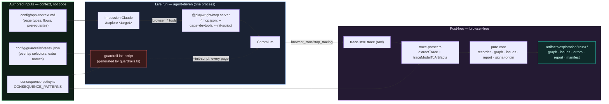
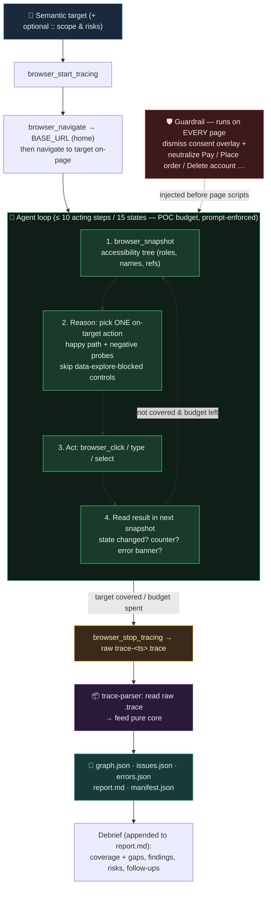

# AI Exploratory — Architecture & Flow

As-built reference for the **autonomous AI exploration** subsystem: given a **semantic
target** (an intent such as `pdp`, `cart`, `guest checkout` — never a URL), optionally
scoped with a `:: <scope & risks>` note, the in-session agent explores the live storefront
(`BASE_URL`), and the run yields a state/transition **graph**, correlated **telemetry**,
and an **issue report** with a session debrief.

It is a second, independent subsystem — it shares no runtime code with the MBT engine.
For the durable _why_ behind the design (and what it replaced), see
[Key decisions](#key-decisions) below; for the terse module list see
[`ARCHITECTURE.md`](ARCHITECTURE.md) → "Autonomous Exploration".

---

## One-paragraph model

The **in-session agent (Claude) drives Microsoft's Playwright MCP directly** —
`browser_navigate` → `browser_snapshot` → reason → `browser_click`/`type`/`select`, one
action per step, with tracing on. Safety is a **page-side guardrail** (an init-script
injected into every page) rather than a tool gate, because the agent calls the browser
directly. When the run ends, a **browser-free post-hoc parser** reads the recorded trace —
the raw, uncompressed `trace-<ts>.trace` the MCP writes (no `unzip`; a bundled `trace.zip`
is a fallback only) — and feeds the **pure exploration core**. There is **no AI SDK and no
API key** — the LLM is the session.

---

## Architecture (structure)



**Two clean seams:** (1) the browser is reached _only_ through the MCP server; (2) the
loop that drives and the recording that reports are **decoupled** — the live run produces
a trace, the parser produces the artifacts. Everything in `src/exploration/` stays
Playwright-free and unit-testable without a browser.

---

## Flow (runtime loop)



The green box is the only live part; the guardrail (red, dashed) is a page-side concern
that applies before every page's own scripts, not a step in the loop; everything from the
amber box on is post-hoc and browser-free.

---

## Components

| Component                 | Where                                          | Role                                                                                                                                           |
| ------------------------- | ---------------------------------------------- | ---------------------------------------------------------------------------------------------------------------------------------------------- |
| `/explore <target>`       | `.claude/commands/explore.md`                  | The agent-driven flow: drive MCP, cover happy paths + negative probes, then parse the trace                                                    |
| Playwright MCP server     | `.mcp.json` (`@playwright/mcp`)                | Drives isolated Chromium; `--caps=devtools` for tracing; `--init-script` for the guardrail                                                     |
| Guardrail generator       | `tests/support/exploration/guardrails.ts`      | Builds the page-side init-script from per-site data + `CONSEQUENCE_PATTERNS`                                                                   |
| Guardrail (runtime)       | `config/guardrails/<site>.init.js` (generated) | On every page: dismiss consent overlay + neutralize consequential controls                                                                     |
| Trace parser              | `tests/support/exploration/trace-parser.ts`    | The only trace reader: `extractTrace` (reads the raw `.trace` directly; `unzip` only for a legacy `.zip`) + pure `traceModelToArtifacts`       |
| Parser runner             | `tests/exploration/parse-run.spec.ts`          | Browser-free task: `EXPLORE_TRACE` → parse → `writeArtifacts` (skipped unless env set)                                                         |
| Recorder / graph / issues | `src/exploration/{recorder,graph,issues}.ts`   | Step counting, ARIA/HTML-hash state identity + dedup, signal correlation, issue fingerprints                                                   |
| Report                    | `src/exploration/report.ts`                    | `report.md` + the full artifact set                                                                                                            |
| Consequence patterns      | `src/exploration/consequence-policy.ts`        | Site-agnostic patterns feeding both the guardrail and the parser's skipped-boundary marking                                                    |
| Signal origin             | `src/exploration/signal-origin.ts`             | First-party vs third-party classification (site vs external vendor)                                                                            |
| App context / routing     | `config/app-context.md`                        | Grounds the agent; every run starts from `BASE_URL` (home) and navigates to the target on-page (no deep-linking)                               |
| Cross-run learnings       | _(dropped)_                                    | The former `config/app-context.learned.md` read/append was removed; each run is now self-contained. A replacement persistence mechanism is TBD |

---

## Safety model (page-side guardrail)

Because the agent calls `browser_click` directly, safety **cannot** be a wrapped tool
gate. Instead, an init-script runs on every page (via the MCP `--init-script`) and:

1. **dismisses** the consent/cookie overlay (site selectors from `config/guardrails/<site>.json`);
2. **neutralizes** any control whose accessible name matches `CONSEQUENCE_PATTERNS`
   (e.g. order / payment / purchase / personal-data / destructive / send / publish — **not**
   login/sign-up/register, which
   are explorable) — capture-phase `preventDefault` + `pointer-events:none` + a
   `data-explore-blocked` marker.

The parser also records any consequential action it sees as a **skipped boundary** in the
report. This is a **page-side defense, not an un-bypassable gate** — weaker than the
retired in-code consequence gate, and an accepted trade for driving MCP directly. The
budget is prompt-enforced by the skill — **10 acting steps / 15 states (POC)**, declared
once in the skill and mirrored by the parser's `STEP_BUDGET`/`STATE_BUDGET` (used only to
label completion `budgetExhausted` vs `targetCovered`).

> **Site knowledge is data, not code.** Overlay selectors, extra consequential names, and
> entry hints live in per-site config files that parameterize the guardrail and ground the
> agent. Adding a new site is authoring data, not writing a browser adapter.

---

## Telemetry & artifacts

Signals are derived from the trace's **console stream** (network 4xx/failures mirror into
console, so no separate correlation is needed): `consoleError`, `httpError`,
`requestFailed`, `pageError`. Each is classified first-party vs third-party so the report
separates real site issues from vendor noise. Issues are deduped by message with a total
`count` and a distinct-`transitions` tally.

Per run under `artifacts/exploration/<run-id>/` (git-ignored):

```text
manifest.json   run id, target, BASE_URL, counts, completion reason (targetCovered | budgetExhausted | noUsefulAction)
graph.json      nodes (states, incl. action names) + edges (transitions, incl. skipped boundaries)
issues.json     deduped potential issues (site vs third-party)
errors.json     raw correlated signal events
report.md       parser evidence (potential issues, skipped boundaries, decision trail);
                the agent then appends a session debrief — coverage checklist, pages reached, findings
evidence/       screenshots
```

---

## Key decisions

The durable "why" behind the design (distilled from the completed migration; full
history is in git):

- **Safety is a page-side guardrail + advisory prompt — NOT a code-enforced tool gate.**
  MS MCP hands the agent `browser_click`, which we can't wrap, so the consequence gate
  moved from an un-bypassable Node gate to a page-side init-script. It is a **defense, not
  a guarantee** — do not assume order/payment/destructive actions are impossible, and
  don't "fix" the missing gate without understanding this trade. (Login/sign-up/register
  are deliberately _not_ blocked — auth flows are fully in scope, **including completing
  registration** with a synthetic test account and a **real sign-in** using the
  `BB_EMAIL`/`BB_PASSWORD` test-account credentials from `.env` (to reach authenticated
  areas); only account _deletion_ and payment/order stay blocked. Credential values are
  treated as secrets — never echoed into reports and only ever in the git-ignored trace.)
- **The agent drives Playwright MCP directly; there is no Node driver loop.** This replaced
  an earlier `coordinator` loop + file channel where the agent was a blind menu-picker
  (it never saw the page). Cost: the drive loop is no longer a deterministic Node program.
- **Recording is post-hoc (trace → parser), decoupled from driving.** The live run only
  produces a trace; artifacts are built afterward, browser-free — which keeps the core
  testable and Playwright-free.
- **Site knowledge is data, not code** — overlay selectors / consequential names / entry
  hints live in `config/` and parameterize the guardrail + ground the agent. Adding a site
  is authoring data.
- **Consume MS `@playwright/mcp` via `npx`; no custom server, no AI SDK/key.** Lighter than
  building a server; the LLM is the session.
- **Removed** (recoverable from git): `PlaywrightHost`, `coordinator`/`decider`/
  `action-ranker`/`host`, the file channel, the self-driving autonomous mode, and dormant
  helpers (`sitemap`/`intent-map`/`app-profile`). Browser-driving is now MS MCP's; the
  loop/choice logic is now the agent's.

## Invariants worth keeping

- `src/exploration/` **imports no Playwright** (like `src/machines/`); import extensions
  are `.js` (ESM/NodeNext). The whole telemetry core is browser-free and unit-tested.
- State identity = hash of a **normalized** snapshot (head/scripts/inter-tag whitespace
  stripped) so trivial differences don't fork a state.
- The **only** component that touches a real trace is `trace-parser.ts`; the transform
  half (`traceModelToArtifacts`) is pure and tested against a hand-authored fixture.
- The guardrail script is **generated** and freshness-checked
  (`UPDATE_GUARDRAILS=1 npx playwright test --project=exploration guardrails`), so it never
  drifts from `guardrails.ts` + the site data.

---

## Run & verify

```bash
# Browser-free suite: core + guardrail generator + trace parser
npm test -- --project=exploration

# Agent-driven live run (needs the Playwright MCP server loaded from .mcp.json)
/explore pdp        # Claude Code slash command
```

**Status:** the code path and every offline piece are verified (guardrail neutralization,
trace parsing end-to-end, browser-free suite green). The live `/explore pdp` acceptance run
against the real storefront is the remaining manual step (it needs a session with the MCP
server loaded). Dependency added: `@playwright/mcp` (via `npx`). The parser reads the raw
`trace-<ts>.trace` directly (the skill picks the newest one — never the possibly-stale
`trace.zip`); the system `unzip` is used only as a fallback for a bundled `.zip`.
