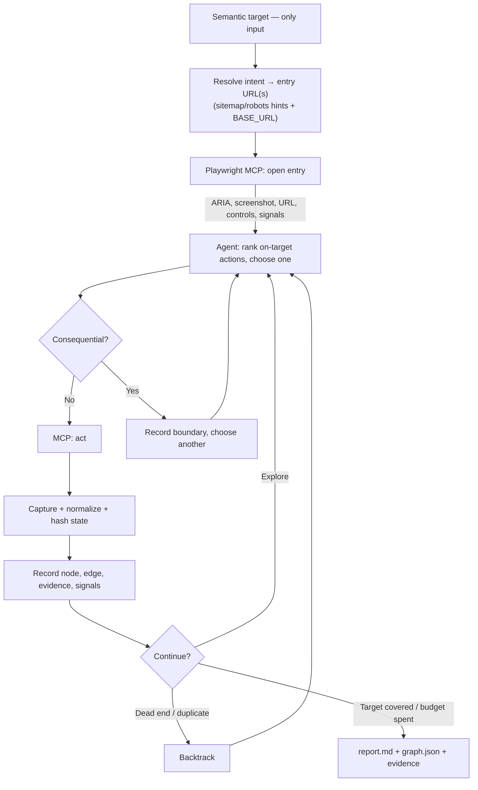

# Autonomous Agent Exploration — Minimal POC Plan

**Status:** **Built** — this design is implemented and running. The core lives in `src/exploration/` (browser-independent), the live browser adapter in `tests/support/exploration/playwright-host.ts`, and the specs in `tests/exploration/` (browser-free) + `tests/exploration-live/` (live). See `docs/ARCHITECTURE.md` ("Autonomous Exploration") and `README.md` ("Autonomous exploration (POC)") for the as-built reference; this file remains the original design record.

The implementation has **evolved beyond this plan**. Notable additions since: application context / app-profile grounding (`app-profile.ts`, `config/app-context.md`), active visible-error detection (`errorShown`) on top of the passive signals in §8, overlay-aware clicking and differentiated settle-wait tuning in the live host, the agent-driven run mode via a file channel (`/explore` command + `file-channel-decider.ts`), first-party vs third-party signal classification (`signal-origin.ts`), and message-level issue dedup with count/affected-transition tallies. The sections below are the design as originally approved.

_Amended 2026-08-18 — input model changed from target-URL to **semantic target**; scope trimmed to a minimal demo core._
**Required input:** one exploration target (intent), e.g. `explore pdp`, `explore cart`, `explore search flows`, `explore guest checkout`.
**Site source:** `BASE_URL` from `.env` (default `https://www.g-star.com/en_nl`). No URL is required from the user.
**Supersedes** the earlier target-URL-only draft of this file. The prior "Phase 1–4 discovery" refactor/removal framing is dropped: that code is not present in this branch, so this is a fresh, self-contained build.

## 1. Outcome

Given a **semantic target** (an intent, not a URL), an agent:

1. resolves the intent to one or more candidate entry pages on `BASE_URL`,
2. uses Playwright MCP to observe the rendered page, choose a useful visible action, act, and capture the result,
3. continues under an internal budget until the target area is covered or no useful action remains,
4. emits an observed state/transition graph, telemetry, and a short report.

The interface is:

```text
explore <target>          # e.g. explore pdp
```

The POC requires **no** URL, config file, journey, action sequence, credentials, or budget from the user. Everything except the target is an internal default.

The POC produces:

- an observed **state/transition graph** (`graph.json`);
- **telemetry**: ARIA snapshots, screenshots, and correlated error/console/network signals;
- a concise **report** (`report.md`) with a potential-issue list.

**Out of the minimal core (deferred):** XState-model generation, checkpoint/replay recovery, POM generation, legacy-removal audit. See §7.

## 2. Direction

- Accept exactly one required input: the **semantic target**.
- Take the site from `BASE_URL`; derive origin, robots/sitemap URLs, run ID, artifact path, safety policy, budget, and stop conditions internally.
- **Resolve intent → entry pages** using robots/sitemap **hints** plus on-page navigation. Robots/sitemap are _advisory_: they seed candidate URLs and page-family coverage, they **never gate** a browser navigation.
- Discover further navigation from links/controls visible on the rendered page — not limited to sitemap membership.
- Use **Playwright MCP** for all page observation and browser actions.
- Let the agent choose one action at a time from: the target intent, current observation, history, hints, and remaining budget.
- **Skip and record** consequential actions (order placement, payment, account creation, personal-data submission, destructive clicks). Never pause an autonomous run for user input.
- Keep the exploration **scoped to the target area**: rank on-target actions first; treat off-target/external navigations as scope exits and backtrack.
- One implementation, no legacy mode or feature flag.

## 3. Intent → entry resolution

The only target-specific logic is a small, declarative map from intent keyword to entry hints. It seeds where to _start_; it does not constrain where the agent may _go_.

| Target keyword        | Entry-hint strategy                                                                |
| --------------------- | ---------------------------------------------------------------------------------- |
| `pdp`                 | first product URL from sitemap (or a product tile clicked from a listing page)     |
| `cart`                | add-to-cart from a resolved PDP, then the cart page                                |
| `search`              | site search control on the homepage; sample a query; explore results               |
| `guest checkout`      | cart → checkout entry, guest path only; stop before any payment/consequential step |
| _(unknown/free-text)_ | homepage; rank visible actions by keyword relevance to the target string           |

Resolution order: sitemap/robots hint → on-page navigation → homepage fallback. Unresolved targets degrade gracefully to homepage exploration biased toward the target words.

## 4. Loop



## 5. Functional requirements

- **FR-00 — Interface:** WHEN exploration is requested, THEN the system SHALL require only one **semantic target** and SHALL derive every other runtime value internally (site from `BASE_URL`).
- **FR-01 — Resolve:** WHEN a session starts, THEN the system SHALL resolve the target to one or more entry pages using robots/sitemap hints and `BASE_URL`, falling back to the homepage.
- **FR-02 — Observe:** WHEN a page is ready, THEN the session SHALL capture URL, ARIA state, screenshot reference, visible actions, and available error/console/network signals.
- **FR-03 — Decide:** WHEN an observation is available, THEN the agent SHALL select the next action ranked by relevance to the **target** and unvisited coverage, using history, hints, and remaining budget.
- **FR-04 — Navigate:** WHEN the agent selects a navigation, THEN the system SHALL execute it without checking sitemap membership or route allowlists.
- **FR-05 — Consequences:** IF an action may cause a persistent external effect, THEN the system SHALL skip it, record the boundary, and continue without prompting.
- **FR-06 — Deduplicate:** WHEN a state is captured, THEN the recorder SHALL hash the normalized ARIA state and avoid re-expanding an already-expanded state/action pair.
- **FR-07 — Record:** WHEN an action completes or fails, THEN the recorder SHALL correlate its result and signals to the source state and graph transition.
- **FR-08 — Complete:** WHEN the target area is covered, no useful action remains, or the internal budget is exhausted, THEN the session SHALL stop with an explicit reason.
- **FR-09 — Report:** WHEN a session stops, THEN the system SHALL emit `graph.json`, telemetry/evidence, and `report.md` with a correlated potential-issue list.

## 6. Increments

Each is independently reviewable and demoable.

### Increment 1 — Recorder + telemetry core (P0)

Pure, browser-independent primitives: TypeScript observation/action/result event types, ARIA normalization + SHA-256 hashing, visited-set, observed graph, issue fingerprints, artifact writer, and the §3 intent→entry hint map fed by robots/sitemap parsing (bounded HTTP). No runtime schema library — events are produced internally, so static types suffice; a lightweight assertion helper covers the few artifact-boundary checks.
**Acceptance:** fixture observations produce deterministic hashes, graph nodes/edges, correlated signals, and a report — no browser required.
**HITL gate:** review event schemas, output shapes, and the intent map before wiring the browser.

### Increment 2 — Playwright MCP loop (P0)

Wire the loop: resolve intent → open entry → observe → rank/choose → consequence-check → act/skip → record → continue/backtrack → stop with reason.
**Acceptance:** `explore <target>` is the only invocation; against `BASE_URL`, one target (e.g. `pdp`) discovers an unprescribed multi-page path, records a backtrack, skips a consequential boundary without prompting, and stops with an explicit reason. No site URL or action sequence is hard-coded in the selection logic (only the §3 intent-hint seed).
**HITL gate:** approve the consequence policy and the target set to demo before live runs.

### Increment 3 — Demo proof (P1)

Run 2–3 targets (`pdp`, `cart`, `guest checkout`) against `BASE_URL` within internal defaults and review outputs.
**Internal defaults:** ~5 min, ~15 unique states, ~30 actions per run.
**Acceptance:** each run starts from only the target; navigations are not sitemap-gated; every transition has evidence; captured errors are correlated; runs stop within budget; `report.md` is readable and useful.

## 7. Deferred (not in minimal core)

Kept out to stay minimal for the demo; add later if the loop proves useful:

- **XState-v5 model generation** from the discovered graph (ties back to the repo's MBT generator).
- **Checkpoint/replay recovery** and interrupted-run resume.
- **POM generation** from discovered locators.
- Any **legacy-removal audit** — there is no prior explorer implementation in this branch to remove.

## 8. Signals and evaluation

Capture around every action: page errors/unhandled exceptions; console errors; failed requests and HTTP 4xx/5xx; action timeout/ambiguity/obstruction/no-change; unexpected origin changes; ARIA-capture failure. An issue becomes a **potential bug** when correlated to a graph transition and reproduced once, or when the agent derives and verifies a visible page-level invariant.

## 9. Artifacts

```text
artifacts/exploration/<run-id>/
  manifest.json      # target, BASE_URL, run id, defaults, completion reason
  routes.json        # sitemap/robots hints used (advisory)
  graph.json         # nodes, edges, evidence refs
  errors.json        # correlated signals
  issues.json        # potential-issue list
  report.md          # human-readable summary
  evidence/          # screenshots, ARIA snapshots
```

## 10. Out of scope for the POC

Direct OpenAI/Anthropic SDK integration; `llms.txt`; distributed/concurrent explorers; cross-session auth; autonomous order placement, payment, account creation, or personal-data submission; user-provided budgets/policies/config files; production-grade graph optimization.

## 11. Approved decisions

1. Input is a **semantic target** (intent), not a URL. Site comes from `BASE_URL`. _(supersedes the prior target-URL decision)_
2. Playwright MCP is the authoritative observation/action interface.
3. robots/sitemap are advisory hints for intent resolution and coverage — never navigation gates.
4. Consequential actions are skipped and recorded; the run never asks for runtime input.
5. Minimal core only (§1); XState generation, recovery/replay, POM generation, and any legacy-removal work are deferred (§7).
6. Validation runs against `BASE_URL` (g-star.com) using internal defaults.

Any change to these requires review before implementation continues.
